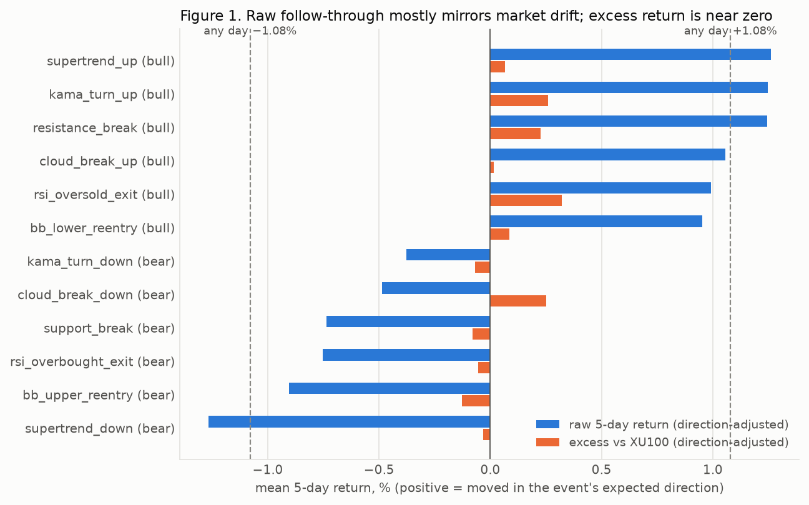
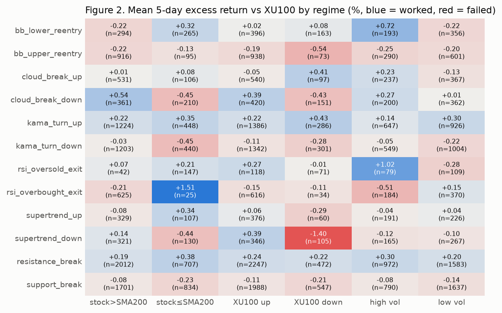

# Report 1 — Technical Reversal Events on 30 BIST 100 Stocks

_Educational research output for CSE-481. Historical evidence only: not a forecast, not investment advice. Returns are nominal TRY._

Generated by `python -m src.reports.build_reports --only 1` from committed outputs (no analysis is re-run).

| file | modified | sha256 |
|:---|:---|:---|
| `reports/technical_events.parquet` | 2026-11-09 19:35:32 | 8f94db7524b6 |
| `reports/event_summary_fwd.csv` | 2026-11-09 19:35:32 | 5c356e6e96c8 |
| `reports/event_summary_exc.csv` | 2026-11-09 19:35:32 | 1af997447063 |
| `reports/event_summary_regime.csv` | 2026-11-09 19:35:32 | cb8dfa12bbd4 |

## 1. Research question

Project spec §8 and §13: treat each technical signal as a **timestamped event**, record the market state at that
time and measure what happened over the next 1, 3, 5 and 10 trading days. The question is not "does the indicator
work" but: **after this event, did the stock move in the expected direction more often or by more than it would
have anyway, and does the answer survive regimes, a later sample and multiple-testing correction?**

**Short answer.** After all 12 event types, the stock did move in the "expected" direction in raw terms, but
almost exactly as much as any random stock-day would have, because BIST 100 rose strongly in nominal TRY over
the sample. Measured against XU100, the average 5-day effect is between −0.13% and +0.32%, no event type
survives multiple-testing correction, and only 4 of 12 keep the same sign in the second half of the sample.
Two bullish events (`kama_turn_up`, `resistance_break`) are the most stable, but their edge (~+0.2–0.3% in 5 days)
is about the size of one round-trip trading cost (0.30% in our backtest).

## 2. Data and method

- Universe: the fixed 30-stock study universe (`config/universe.csv`), daily İş Yatırım prices,
  2021-11-16 – 2026-11-06.
- Events are detected using only today's and earlier data (`src/events/technical_events.py: detect_events`).
  If the same event repeats within 5 trading days for a stock, only the first is kept.
- **Direction-adjusted return**: for a bullish event the forward return, for a bearish event minus the forward
  return. Positive always means "moved the way the event suggested".
- **Raw** = stock's own forward return. **Excess** = stock return minus XU100 return over the same horizon.
- **Any-day baseline**: forward return from *every* stock-day (no event), the "knowing nothing" benchmark.
- The Kahramanmaraş earthquake window (events whose 10-day horizon touches 6–24 Feb 2023, 244 events) is
  excluded; Borsa İstanbul was closed 8–14 Feb 2023 and prices were not comparable.
- Regimes: the stock above/below its own 200-day SMA; XU100 above/below its 200-day SMA; XU100 20-day volatility
  above/below its expanding median (needs 250 days, earlier rows are "unknown" and left out of those columns).
- Statistics: t-test of the mean; because many stocks fire on the same day, a **day-clustered t** (mean per day
  first) is reported and used for p-values; Benjamini–Hochberg q across the 12 event types.

**Table 1. Event definitions**

| event | family | dir | definition |
|:---|:---|:---|:---|
| bb_lower_reentry | Bollinger | bull | close was below the lower band (20, 2σ) yesterday and is back inside today |
| bb_upper_reentry | Bollinger | bear | close was above the upper band yesterday and is back inside today |
| rsi_oversold_exit | RSI | bull | RSI(14) crosses back above 30 (exit from oversold; local-trough proxy) |
| rsi_overbought_exit | RSI | bear | RSI(14) crosses back below 70 (exit from overbought; local-peak proxy) |
| supertrend_up | Supertrend | bull | Supertrend(10, 3×ATR) direction flips to up |
| supertrend_down | Supertrend | bear | Supertrend direction flips to down |
| kama_turn_up | KAMA | bull | KAMA(10, 2, 30) slope turns from ≤0 to >0 |
| kama_turn_down | KAMA | bear | KAMA slope turns from ≥0 to <0 |
| cloud_break_up | Ichimoku | bull | price moves from inside/below the cloud (9, 26, 52) to above it |
| cloud_break_down | Ichimoku | bear | price moves from inside/above the cloud to below it |
| resistance_break | Support/Resistance | bull | close crosses above yesterday's nearest pivot resistance |
| support_break | Support/Resistance | bear | close crosses below yesterday's nearest pivot support |

## 3. Main result: event follow-through at 5 days

Any-day baseline (all stock-days, no event): 5-day mean **+1.08%**, positive in
**55.1%** of cases (1d +0.22%, 10d +2.11%).

**Table 2. Direction-adjusted 5-day returns (%), earthquake window excluded**

| event | dir | n | raw 5d % | raw hit % | excess 5d % | excess hit % | t | t (by day) | p (by day) | days | q BH | raw vs any-day |
|:---|:---|---:|---:|---:|---:|---:|---:|---:|---:|---:|---:|---:|
| bb_lower_reentry | bull | 632 | 0.95 | 54.91 | 0.08 | 46.99 | 0.43 | -0.35 | 0.726 | 266 | 0.958 | -0.13 |
| bb_upper_reentry | bear | 1,187 | -0.90 | 44.65 | -0.13 | 52.65 | -0.79 | -1.01 | 0.311 | 580 | 0.747 | 0.17 |
| cloud_break_up | bull | 718 | 1.06 | 54.87 | 0.01 | 44.99 | 0.08 | 0.34 | 0.737 | 428 | 0.958 | -0.02 |
| cloud_break_down | bear | 633 | -0.49 | 48.50 | 0.25 | 56.40 | 1.40 | 2.04 | 0.042 | 372 | 0.508 | 0.59 |
| kama_turn_up | bull | 1,948 | 1.25 | 54.11 | 0.26 | 46.15 | 2.30 | 1.18 | 0.237 | 731 | 0.711 | 0.17 |
| kama_turn_down | bear | 1,923 | -0.38 | 48.67 | -0.07 | 50.91 | -0.61 | -0.45 | 0.649 | 724 | 0.958 | 0.70 |
| rsi_oversold_exit | bull | 218 | 0.99 | 55.05 | 0.32 | 46.79 | 1.02 | 0.27 | 0.791 | 130 | 0.958 | -0.09 |
| rsi_overbought_exit | bear | 786 | -0.75 | 44.53 | -0.05 | 52.54 | -0.27 | 0.12 | 0.905 | 415 | 0.960 | 0.33 |
| supertrend_up | bull | 521 | 1.26 | 56.43 | 0.07 | 45.49 | 0.29 | 0.05 | 0.960 | 324 | 0.960 | 0.18 |
| supertrend_down | bear | 539 | -1.27 | 41.56 | -0.03 | 52.88 | -0.15 | 0.26 | 0.798 | 254 | 0.958 | -0.19 |
| resistance_break | bull | 3,104 | 1.24 | 55.70 | 0.23 | 48.13 | 2.53 | 1.40 | 0.162 | 938 | 0.648 | 0.16 |
| support_break | bear | 2,849 | -0.74 | 45.88 | -0.08 | 51.46 | -0.89 | 1.50 | 0.135 | 855 | 0.648 | 0.34 |

"raw vs any-day" = raw mean minus what the baseline drift alone gives in that direction
(+1.08% for bullish, −1.08% for bearish events).
Events with q < 0.05 on excess return (day-clustered): **none**.

**Reading Table 2 and Figure 1.**

- Bullish events show a raw 5-day gain of +0.95% to +1.26% and a positive outcome in 54–56% of cases. The
  any-day baseline is +1.08% and 55.1%. So the raw "success" is mostly **market drift**, not the signal.
- Bearish events look like failures in raw terms (raw hit 42–49%): stocks kept rising after a "sell" signal
  simply because the whole market was rising.
- Once XU100 is subtracted (orange bars), every event type is within ±0.35%. The lowest day-clustered p-value
  (`cloud_break_down`, p = 0.042) becomes q = 0.51 after correction for 12 tests.
- Clustering matters: `kama_turn_up` and `resistance_break` have event-level t = 2.30 and 2.53, but many of these
  events happen on the same days across stocks. Averaging per day first cuts t to 1.18 and 1.40. The plain t-test
  overstates confidence.

## 4. Bounce / failure counts and reversal strength

A **bounce** is a positive direction-adjusted raw 5-day return, a **failure** is zero or negative.
Reversal strength is the median direction-adjusted return (medians resist a few extreme days).

**Table 3. Bounce and failure counts**

| event | n | bounce (5d) | failure (5d) | median strength 5d % | median strength 10d % | median excess 5d % | excess failure % |
|:---|---:|---:|---:|---:|---:|---:|---:|
| bb_lower_reentry | 632 | 347 | 279 | 0.85 | 0.99 | -0.33 | 52.1 |
| bb_upper_reentry | 1,187 | 530 | 657 | -0.86 | -1.60 | 0.33 | 47.3 |
| cloud_break_up | 718 | 394 | 322 | 0.82 | 0.87 | -0.50 | 54.7 |
| cloud_break_down | 633 | 307 | 325 | -0.21 | -0.50 | 0.60 | 43.4 |
| kama_turn_up | 1,948 | 1,054 | 873 | 0.71 | 1.12 | -0.30 | 52.8 |
| kama_turn_down | 1,923 | 936 | 982 | -0.14 | -1.04 | 0.11 | 48.8 |
| rsi_oversold_exit | 218 | 120 | 89 | 1.12 | 0.58 | -0.08 | 49.1 |
| rsi_overbought_exit | 786 | 350 | 436 | -0.89 | -1.75 | 0.51 | 47.5 |
| supertrend_up | 521 | 294 | 220 | 0.92 | 0.85 | -0.56 | 53.2 |
| supertrend_down | 539 | 224 | 315 | -1.34 | -1.42 | 0.33 | 47.1 |
| resistance_break | 3,104 | 1,729 | 1,356 | 0.88 | 1.28 | -0.17 | 51.3 |
| support_break | 2,849 | 1,307 | 1,539 | -0.52 | -0.86 | 0.15 | 48.4 |

**Bounce counts look good; the typical event does not.** Lower-band re-entries bounced 347 times and failed
279 times, which reads like a usable reversal signal. But the **median** excess return of every bullish event is
negative (−0.08% to −0.56%) while the mean is slightly positive. The typical bullish event slightly
underperformed XU100, and a minority of large winners pulled the average up. A rule that trades every event
collects mostly the typical case.

## 5. Horizons

**Table 4. Mean direction-adjusted excess return vs XU100 by horizon (%)**

| event | excess 1d % | excess 3d % | excess 5d % | excess 10d % |
|:---|---:|---:|---:|---:|
| bb_lower_reentry | -0.13 | -0.03 | 0.08 | 0.12 |
| bb_upper_reentry | 0.11 | -0.03 | -0.13 | -0.58 |
| cloud_break_up | 0.03 | 0.11 | 0.01 | 0.18 |
| cloud_break_down | 0.01 | 0.10 | 0.25 | 0.38 |
| kama_turn_up | 0.09 | 0.18 | 0.26 | 0.33 |
| kama_turn_down | 0.07 | -0.15 | -0.07 | -0.23 |
| rsi_oversold_exit | -0.17 | 0.20 | 0.32 | 0.50 |
| rsi_overbought_exit | 0.11 | -0.10 | -0.05 | -0.51 |
| supertrend_up | 0.16 | 0.07 | 0.07 | 0.19 |
| supertrend_down | 0.03 | 0.03 | -0.03 | 0.05 |
| resistance_break | 0.13 | 0.16 | 0.23 | 0.37 |
| support_break | 0.06 | -0.01 | -0.08 | -0.25 |

Effects grow slowly with the horizon for the two stable bullish events (`kama_turn_up` +0.09% → +0.33%,
`resistance_break` +0.13% → +0.37% from 1 to 10 days), which looks more like mild trend continuation than a
sharp reversal. Bearish band/RSI exits (`bb_upper_reentry`, `rsi_overbought_exit`) get *worse* at 10 days
(−0.58%, −0.51%): after an overbought exit, the stock tended to keep outperforming the index. That is momentum,
the opposite of the reversal the event name suggests.

## 6. Regimes

**Table 5. Mean 5-day excess return (%) and event count by regime**

| event | stock>SMA200 | stock≤SMA200 | XU100 up | XU100 down | high vol | low vol |
|:---|:---|:---|:---|:---|:---|:---|
| bb_lower_reentry | -0.22 (294) | +0.32 (265) | +0.02 (396) | +0.08 (163) | +0.72 (193) | -0.22 (356) |
| bb_upper_reentry | -0.22 (916) | -0.13 (95) | -0.19 (938) | -0.54 (73) | -0.25 (290) | -0.20 (601) |
| cloud_break_up | +0.01 (531) | +0.08 (106) | -0.05 (540) | +0.41 (97) | +0.23 (237) | -0.13 (367) |
| cloud_break_down | +0.54 (361) | -0.45 (210) | +0.39 (420) | -0.43 (151) | +0.27 (200) | +0.01 (362) |
| kama_turn_up | +0.22 (1224) | +0.35 (448) | +0.22 (1386) | +0.43 (286) | +0.14 (647) | +0.30 (926) |
| kama_turn_down | -0.03 (1203) | -0.45 (440) | -0.11 (1342) | -0.28 (301) | -0.05 (549) | -0.22 (1004) |
| rsi_oversold_exit | +0.07 (42) | +0.21 (147) | +0.27 (118) | -0.01 (71) | +1.02 (79) | -0.28 (109) |
| rsi_overbought_exit | -0.21 (625) | +1.51 (25) | -0.15 (616) | -0.11 (34) | -0.51 (184) | +0.15 (370) |
| supertrend_up | -0.08 (329) | +0.34 (107) | +0.06 (376) | -0.29 (60) | -0.04 (191) | +0.04 (226) |
| supertrend_down | +0.14 (321) | -0.44 (130) | +0.39 (346) | -1.40 (105) | -0.12 (165) | -0.10 (267) |
| resistance_break | +0.19 (2012) | +0.38 (707) | +0.24 (2247) | +0.22 (472) | +0.30 (972) | +0.20 (1583) |
| support_break | -0.08 (1701) | -0.23 (834) | -0.11 (1988) | -0.21 (547) | -0.08 (790) | -0.14 (1637) |

**Regimes change the answer, which is a warning, not a discovery.**

- Mean-reversion events work better in **high volatility**: `bb_lower_reentry` +0.72% (n = 193) and
  `rsi_oversold_exit` +1.02% (n = 79), against −0.22% and −0.28% in low volatility. This matches the spec's
  ASELS illustration, but the samples are small and these cells are not corrected for the ~70 regime tests.
- Bearish trend signals fail when the index is already falling: `supertrend_down` −1.40% (n = 105) in XU100-down
  periods. After a sell flip in a falling market, the stock fell *less* than the index.
- Cells with n < 50 (for example `rsi_overbought_exit` below its SMA200, +1.51% with n = 25) should be read as
  noise.

## 7. Combined condition: volume confirmation

The spec's ASELS example asks whether events with confirming conditions behave differently than single-indicator
events. The stored events carry one confirmation flag: 20-day volume z-score > 1 on the event day.

**Table 6. Excess 5-day return with and without volume confirmation (%)**

| event | n (normal vol) | excess 5d % (normal) | n (volume z>1) | excess 5d % (volume z>1) | difference |
|:---|---:|---:|---:|---:|---:|
| bb_lower_reentry | 518 | 0.10 | 114 | 0.01 | -0.09 |
| bb_upper_reentry | 967 | -0.14 | 220 | -0.08 | 0.06 |
| cloud_break_up | 455 | -0.04 | 263 | 0.11 | 0.16 |
| cloud_break_down | 518 | 0.16 | 115 | 0.66 | 0.50 |
| kama_turn_up | 1,422 | 0.23 | 526 | 0.35 | 0.12 |
| kama_turn_down | 1,644 | -0.08 | 279 | 0.00 | 0.08 |
| rsi_oversold_exit | 155 | 0.29 | 63 | 0.41 | 0.12 |
| rsi_overbought_exit | 656 | 0.01 | 130 | -0.38 | -0.39 |
| supertrend_up | 235 | 0.03 | 286 | 0.10 | 0.07 |
| supertrend_down | 430 | 0.03 | 109 | -0.27 | -0.30 |
| resistance_break | 2,179 | 0.15 | 925 | 0.41 | 0.26 |
| support_break | 2,432 | -0.12 | 417 | 0.12 | 0.24 |

Volume confirmation helps the breakout-type events a little: `resistance_break` +0.15% → +0.41%,
`cloud_break_down` +0.16% → +0.66%, `kama_turn_up` +0.23% → +0.35%. It hurts the bearish exhaustion events
(`rsi_overbought_exit` +0.01% → −0.38%, `supertrend_down` +0.03% → −0.27%). In other words, high volume tends to
mean "the move continues". These differences were not tested for significance and are a hypothesis for later
work, not a rule.

## 8. Out-of-sample check: first half vs second half

The sample is split at **2024-05-12**. A pattern worth trusting should keep at least its sign.

**Table 7. Mean 5-day excess return (%) in each half**

| event | n first half | excess 5d % first | n second half | excess 5d % second | same sign |
|:---|---:|---:|---:|---:|:---|
| bb_lower_reentry | 231 | -0.20 | 401 | 0.25 | no |
| bb_upper_reentry | 686 | -0.05 | 501 | -0.24 | yes |
| cloud_break_up | 313 | -0.15 | 405 | 0.14 | no |
| cloud_break_down | 208 | 1.19 | 425 | -0.21 | no |
| kama_turn_up | 893 | 0.21 | 1,055 | 0.30 | yes |
| kama_turn_down | 881 | 0.07 | 1,042 | -0.18 | no |
| rsi_oversold_exit | 72 | 0.56 | 146 | 0.20 | yes |
| rsi_overbought_exit | 505 | -0.19 | 281 | 0.19 | no |
| supertrend_up | 248 | 0.15 | 273 | -0.01 | no |
| supertrend_down | 245 | 0.57 | 294 | -0.53 | no |
| resistance_break | 1,379 | 0.27 | 1,725 | 0.19 | yes |
| support_break | 1,127 | 0.16 | 1,722 | -0.24 | no |

Same sign in both halves: **4 of 12** event types.

Only `kama_turn_up`, `resistance_break`, `rsi_oversold_exit` and `bb_upper_reentry` keep their sign in both
halves. The largest first-half effect (`cloud_break_down` +1.19%) turns into −0.21%. The two halves are very
different markets (see Türkiye context): the first is the negative-real-rate boom, the second is the tight-policy
period with two political/financial shocks. A sign flip across them is what we would expect from a pattern that
is regime-specific or accidental.

## 9. Multiple testing

This report alone looks at 12 event types × 4 horizons × 2 return definitions
(raw, excess) plus 6 regime cuts, more than 100 numbers. At a 5% level, about 1 in 20 would look
"significant" by chance. That is why Table 2 uses day-clustered p-values and Benjamini–Hochberg q, and why a
result is only called a finding when it also keeps its sign out of sample (Table 7).

Read as a whole, the evidence is **"no reliable reversal edge beyond the market"**. If we had picked the best
cell in the regime table (+1.51%) and reported it alone, it would look like a strong finding. That is exactly the
data-snooping risk the project brief warns about.

## 10. Türkiye context

The sample (Nov 2021 – Nov 2026) covers very different Turkish market regimes. These dates explain much of the
drift and the regime and half-sample differences above:

- **Dec 2021 – 2022: currency crisis and negative real rates.** The lira crisis of December 2021 and the
  FX-protected deposit scheme were followed by a year of high inflation (CPI peaked above 80% in late 2022) with a
  low policy rate. Equities became an inflation hedge and XU100 rose very strongly in nominal TRY. This is the main
  source of the positive any-day baseline.
- **Feb 2023: Kahramanmaraş earthquakes.** Borsa İstanbul suspended trading 8–14 Feb 2023. This window is
  excluded. XU100 20-day volatility peaked in Q1 2023 (annualised ≈ 46%).
- **Jun 2023 – Mar 2024: monetary tightening.** After the May 2023 elections the policy rate was raised step by
  step to 50%. The sample split (12 May 2024) falls just after this, so the second half is the tight-money market.
- **Mar–Jun 2025: political shock.** On 19 March 2025 the detention of İstanbul's mayor caused two
  circuit-breaker halts. The index lost about 16% in a week, the worst week since 2008, and the central bank
  tightened (overnight lending rate 46%). Our data shows XU100 below its 200-day average for most of
  Mar–Jun 2025.
- **Sep–Nov 2026: fund crisis.** On 17 Sep 2026 the Capital Markets Board (SPK) ordered the liquidation of 131
  funds. Financial press reports a ~25% fall in BIST 100 between 31 Aug and 30 Oct 2026, the sharpest two-month fall
  since 2008, together with an MSCI decision on 15 Oct to freeze some Türkiye index changes. In our data
  XU100 drops below its 200-day average on 18 Sep 2026, the next trading day, and stays there until the data ends
  (6 Nov 2026).

Verified by search: the March 2025 and Sep–Oct 2026 events (news sources listed in the final report). From
general knowledge, not re-checked here: the 2021–2024 items. The 2026 figures come from press reports that
differ slightly from one another.

## 11. How the harness uses these results

The harness (Step 11–13) does not trust a technical event by itself:

- A bullish event in the last 3 trading days, with no bearish event alongside it, can make the stock a
  `TECHNICAL_REVERSAL_CANDIDATE`.
- Every recent event carries its **historical** direction-adjusted 5-day hit rate vs XU100. Only events whose
  5-day window had already closed on the analysis date are used. A rate below 50% adds a "not better than a coin
  flip" soft warning; three soft warnings turn the quality gate to `INVESTIGATE`.
- If bullish and bearish events appear in the same 3-day window (**conflicting signals**), the action is
  `INVESTIGATE`. A candidate with a shock or negative news is still `REJECT_SIGNAL`.

**Bug found while writing this report.** The harness hit rate ignored the event direction, so for bearish events
it counted "stock beat XU100", which is the *failure* case. Example: `kama_turn_down` was shown as 49% instead
of 51%. In the PETKM experiment case, two of its three coin-flip warnings came from this bug, and they alone
produced `INVESTIGATE`. After the fix (direction-adjusted rate plus a test that fails without it), PETKM would have
fallen to `WATCH`. The conflicting-signal rule above was added so that PETKM is `INVESTIGATE` for the right reason.
The PETKM and KRDMD D/E experiment rows were re-run with the corrected code.

## 12. Limitations

- **Missing event families.** The spec's middle-Bollinger-band test and support/resistance *touches* (as opposed
  to breaks) are not stored as events. RSI local troughs/peaks are approximated by exits from the 30/70 zones, and
  divergence is not detected.
- **No maximum-excursion measure.** Reversal strength is the median return at fixed horizons, not the largest
  favourable move inside the window.
- **Only nominal TRY returns.** High inflation inflates raw returns. The excess-vs-XU100 column is the fair
  comparison.
- **Overlapping windows.** 5-day windows overlap and events cluster on market-wide days. Day-clustering reduces
  but does not remove this dependence.
- **Arbitrary choices.** Regime thresholds (200-day SMA, expanding-median volatility) and the 5-day dedupe gap
  are fixed choices and were not optimised. Other choices could move individual cells.
- **Survivorship.** The universe is the 2026 list of 30 stocks, so firms that left the index are not included.

## 13. Conclusion

Technical reversal events are useful as **timestamped context**: they say what the chart is doing. On these 30
stocks over five years, they do not give a reliable edge over simply holding the index once market drift,
clustering, multiple testing and a later sample are taken into account. This is the "prediction ≠ profitable
strategy" distinction in practice: an event can be right more than half the time in raw terms and still add
nothing after the benchmark and costs. The harness therefore uses these events only together with sector,
fundamental and risk-gate evidence, never alone.
