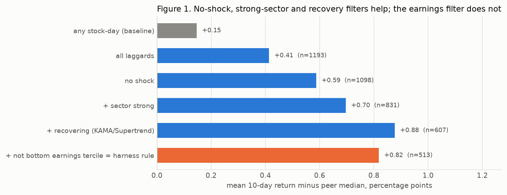
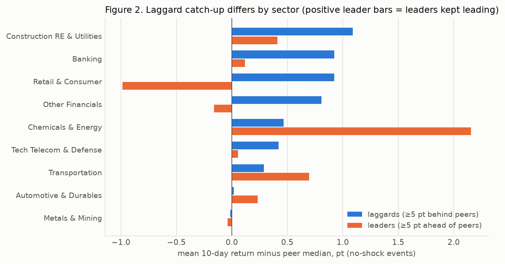

# Report 2 — Sector Laggards and Catch-Up

_Educational research output for CSE-481. Historical evidence only: not a forecast, not investment advice. Returns are nominal TRY._

Generated by `python -m src.reports.build_reports --only 2` from committed outputs (no analysis is re-run).

| file | size | sha256 |
|:---|:---|:---|
| `reports/sector_events.parquet` | 376 kB | bc701afe3f64 |
| `reports/sector_summary_gap.csv` | 1 kB | 1a75fd0ff93e |
| `reports/sector_summary_by_group.csv` | 6 kB | 1ee51208f392 |
| `reports/earnings_events.parquet` | 218 kB | 1b0b994a4a23 |
| `reports/backtest_strategies.csv` | 6 kB | 5266ca6a8032 |
| `reports/backtest_cost_sensitivity.csv` | 1 kB | 5adf4069e31b |

## 1. Research question

Project spec §11: find stocks that are **materially lagging their own sector while the sector is strong**, and
test whether such laggards historically **caught up with their peers** over 5/10/20 trading days, before
treating any of them as a candidate. The spec also asks to separate structural from temporary laggards, to backtest
the rule and to report false positives.

**Short answer.** There is a small but real catch-up effect. A stock that falls at least 5 points behind its
peers in 10 days, without a price shock, beats its peers by +0.59 pt on average over the next 10 days. A random
stock-day gives +0.15. This is the only result in the report that survives multiple-testing correction
(q = 0.041). The harness's extra conditions (strong sector, price recovering) raise the effect to about +0.8–0.9 pt,
and only the full harness rule keeps most of its size in the second half of the sample (+0.88 → +0.72, while the
other laggards fall from +1.00 to +0.02).

The effect is small and noisy:

- About half of the laggards (48–50%) are still behind their peers 20 days later.
- About 29% fall more than 5 points further behind.
- The long-only strategy built on the idea (B_sektor) roughly matches XU100 over the whole period (−1 pt), beats
  it in the first half and lags it in the second half.

## 2. Data and method

- **Peer groups** (`config/universe.csv`, Step 1). The 30 study stocks plus a few extra BIST 100 peers used only
  to compute sector medians. Groups smaller than 3 are not used for events.

| peer group | size | members |
|:---|---:|:---|
| Automotive & Durables | 3 | FROTO, TOASO, ARCLK |
| Banking | 4 | AKBNK, GARAN, ISCTR, YKBNK |
| Chemicals & Energy | 4 | TUPRS, SASA, GUBRF, PETKM |
| Construction RE & Utilities | 5 | ENKAI, OYAKC, EKGYO, ENJSA, AKSEN |
| Healthcare | 2 | MPARK, ECILC |
| Metals & Mining | 3 | EREGL, KRDMD, TRALT |
| Other Financials | 3 | KCHOL, ISMEN, TURSG |
| Retail & Consumer | 4 | BIMAS, MGROS, MAVI, CCOLA |
| Tech Telecom & Defense | 3 | ASELS, TCELL, TTKOM |
| Transportation | 3 | THYAO, PGSUS, TAVHL |

- **Lag** = stock's n-day return − median n-day return of its peers (the stock itself excluded).
  Negative = behind its sector.
- **Trigger**: the first day the lag crosses the threshold. Two settings: `lag10_5pct` (10 days, ≥5 pt; the
  harness rule) and `lag20_10pct` (20 days, ≥10 pt). The same stock cannot trigger again within 10
  trading days. **Leaders** (≥ threshold *ahead* of peers) are the mirror test.
- **Outcome**: `gap_h` = stock's next-h-day return − peers' median next-h-day return, in percentage points.
  Positive for a laggard = it caught up.
- **Shock** = a daily move of at least ±9.5% (close to the ±10% price limit) in the 10 days
  before the trigger. Such lags are usually news-driven, not "temporary".
- Earthquake window excluded (163 events). Statistics: day-clustered t-test (one mean per trigger day) and
  Benjamini–Hochberg q.
- Any-day baseline (every eligible stock-day): gap 5d **+0.09**, 10d **+0.15**,
  20d **+0.34** pt. This is slightly positive because peer medians and single-stock means differ
  (skewed returns).

## 3. Main result: laggards vs leaders

**Table 1. Mean gap vs peers (pt) after the trigger, earthquake window excluded**

| config | side | shock | n | gap 5d | gap 10d | gap 20d | hit 10d % | t (by day) | p (by day) | days | q BH |
|:---|:---|:---|---:|---:|---:|---:|---:|---:|---:|---:|---:|
| lag10_5pct | laggard | no | 1,098 | 0.26 | 0.59 | 0.75 | 52.1 | 2.81 | 0.005 | 718 | 0.041 |
| lag10_5pct | laggard | yes | 95 | -1.82 | -1.62 | -1.26 | 46.2 | -1.69 | 0.095 | 83 | 0.353 |
| lag10_5pct | leader | no | 1,052 | -0.08 | 0.29 | 0.54 | 48.4 | 1.51 | 0.132 | 692 | 0.353 |
| lag10_5pct | leader | yes | 114 | -0.69 | -0.57 | -0.25 | 45.9 | -0.40 | 0.693 | 100 | 0.902 |
| lag20_10pct | laggard | no | 588 | 0.11 | 0.37 | 0.28 | 51.3 | 0.91 | 0.363 | 467 | 0.726 |
| lag20_10pct | laggard | yes | 67 | -0.09 | -0.24 | -0.31 | 47.0 | -0.33 | 0.743 | 59 | 0.902 |
| lag20_10pct | leader | no | 560 | 0.15 | -0.00 | 0.66 | 49.0 | 0.12 | 0.902 | 446 | 0.902 |
| lag20_10pct | leader | yes | 72 | -1.16 | 0.26 | 0.84 | 45.8 | 0.23 | 0.817 | 70 | 0.902 |

**Reading Table 1.**

- **No-shock laggards** (`lag10_5pct`): +0.26 / +0.59 / +0.75 pt at 5 / 10 / 20 days, hit rate 52.1%. The
  baseline is +0.09 / +0.15 / +0.34, so the extra catch-up is roughly +0.4 pt per 10 days.
- **Laggards with a shock** behave the other way: −1.82 pt at 5 days, and they keep lagging. A ±10%-limit day
  usually means news (earnings, a capital increase, a legal problem). This is why the harness treats a shock as a
  blocker (`REJECT_SIGNAL`), not as a bargain.
- **The slower setting** (`lag20_10pct`, 10 pt in 20 days) is weaker (+0.37 pt, q = 0.73). A deeper, longer
  lag is more often a real change than noise.
- **Leaders do not reverse.** Their gap stays near zero or slightly positive (+0.29 at 10 days, not significant).
  Being ahead of the sector is not a reason to expect a fall.

## 4. Does the harness's catch-up rule help?

The harness labels `POTENTIAL_CATCH_UP_CANDIDATE` only if the stock is a `lag10_5pct` laggard **and** has no
shock, **and** its sector median return is positive, **and** it is recovering (close above KAMA or Supertrend up),
**and** its last visible earnings are not in the bottom third. Table 2 adds these filters one at a time.

**Table 2. Filter ladder (lag10_5pct laggards, gap vs peers in pt)**

| step | n | gap 5d | gap 10d | gap 20d | hit 10d % | t (by day) | p (by day) |
|:---|---:|---:|---:|---:|---:|---:|---:|
| any stock-day (baseline) | – | 0.09 | 0.15 | 0.34 | – | – | – |
| all laggards | 1,193 | 0.09 | 0.41 | 0.59 | 51.6 | 2.05 | 0.041 |
| no shock | 1,098 | 0.26 | 0.59 | 0.75 | 52.1 | 2.81 | 0.005 |
| + sector strong | 831 | 0.45 | 0.70 | 1.18 | 52.8 | 3.02 | 0.003 |
| + recovering (KAMA/Supertrend) | 607 | 0.43 | 0.88 | 1.26 | 54.4 | 3.15 | 0.002 |
| + not bottom earnings tercile = harness rule | 513 | 0.16 | 0.82 | 1.18 | 53.6 | 2.80 | 0.005 |

- **Shock filter:** removing shock cases is the single most useful step (+0.41 → +0.59).
- **Sector strength and price recovery:** requiring both pushes the 10-day gap to +0.88 pt (hit rate 54.4%).
- **Earnings filter:** the last harness filter (drop laggards whose latest earnings are in the bottom third)
  does **not** help here: 10 days +0.88 → +0.82, 5 days +0.43 → +0.16. The 94 events it removes caught up
  *better* than the rest (+1.20 pt at 10 days). We keep it in the harness because it is a defensible risk rule: do
  not call a fundamentally weakening company a "temporary" laggard. But this table shows it is a judgement, not
  something the data proved. (The thirds are decided without look-ahead, against the previous quarter's cut-offs;
  see Report 4.)

## 5. Structural vs temporary laggards

The spec asks whether a lag is **structural** (the company is weaker) or **temporary**. We use evidence
available on the trigger day: the latest earnings tercile already public (point-in-time, from KAP publish dates),
whether the sector itself is strong, whether the price is recovering, and the macro risk flag used by the
strategies (XU100 below its 200-day average or a USD/TRY spike). All rows are no-shock `lag10_5pct` laggards.

**Table 3a. By latest public earnings tercile (year-over-year net-income change, across the 30 stocks)**

| tercile | n | gap 10d | gap 20d | hit 10d % | t (by day) |
|:---|---:|---:|---:|---:|---:|
| bottom third | 224 | 0.08 | -0.05 | 52.3 | -0.07 |
| middle third | 212 | 0.65 | 0.80 | 53.3 | 1.07 |
| top third | 238 | 0.48 | 1.30 | 52.7 | 0.91 |
| statement public, quarter not ranked | 313 | 0.69 | 0.84 | 49.8 | 2.15 |
| no statement public yet | 111 | 1.39 | 0.80 | 54.1 | 1.81 |

**Table 3b. By sector strength**

| sector_strong | n | gap 10d | gap 20d | hit 10d % | t (by day) |
|:---|---:|---:|---:|---:|---:|
| sector median > 0 | 831 | 0.70 | 1.18 | 52.8 | 3.02 |
| sector median ≤ 0 | 267 | 0.24 | -0.65 | 49.6 | 0.46 |

**Table 3c. By price recovery**

| recovering | n | gap 10d | gap 20d | hit 10d % | t (by day) |
|:---|---:|---:|---:|---:|---:|
| above KAMA or Supertrend up | 664 | 0.73 | 1.06 | 52.9 | 2.81 |
| below KAMA and Supertrend down | 434 | 0.36 | 0.26 | 50.8 | 1.10 |

**Table 3d. By macro risk flag**

| macro_risk | n | gap 10d | gap 20d | hit 10d % | t (by day) |
|:---|---:|---:|---:|---:|---:|
| macro risk on (half weight) | 365 | 0.21 | 0.31 | 50.8 | 0.61 |
| macro risk off | 733 | 0.77 | 0.96 | 52.7 | 2.99 |

**Which evidence separates structural from temporary laggards?**

- **Sector strength** (Table 3b) separates them best. When the sector itself is falling, laggards do not catch
  up over 20 days (−0.65 pt); when the sector is rising they do (+1.18 pt). A stock left behind by a rising sector
  is more often temporary. A stock falling with a falling sector is just part of the sector's move.
- **Price recovery** (Table 3c) helps: +0.73 vs +0.36 at 10 days.
- **Macro risk** (Table 3d) matters. When XU100 is below its 200-day average or USD/TRY is spiking, catch-up
  mostly disappears (+0.21 vs +0.77). In stress periods investors sell the weaker names and do not rotate back.
- **Earnings tercile** (Table 3a) points the expected way but weakly. Across all no-shock laggards, those whose
  latest earnings are in the bottom third show no catch-up (+0.08 pt at 10 days, −0.05 at 20), while middle- and
  top-third laggards do (+0.65 / +0.48 at 10 days, +0.80 / +1.30 at 20). The t-values are small, and inside the
  harness's filtered set the bottom-third events caught up well (see the ladder), so this is a hypothesis, not a
  rule. "Statement public, quarter not ranked" are dates whose latest statement falls in the inflation-accounting
  switch (2022Q4 – 2024Q1), when no comparable previous-quarter cut-offs exist.

## 6. By sector

Catch-up is clearest in Construction/Real Estate/Utilities (+1.09 pt), Banking (+0.92, but only 19 events) and
Retail & Consumer (+0.92). It is absent in Metals & Mining (−0.02) and Automotive (+0.02). Leaders in Chemicals &
Energy kept leading strongly (+2.15 pt). This group mixes a refiner (TUPRS), a fertiliser maker (GUBRF) and two
petrochemical firms (SASA, PETKM) whose prices follow different commodities, so a "sector median" there is a
weak benchmark. These per-sector numbers are each based on 19–207 events and were not corrected for 18 tests;
they describe the sample rather than prove differences.

## 7. False positives: laggards that kept lagging

**Table 4. Share of no-shock laggards still behind peers 20 days later**

| group | n | still behind peers after 20d % | fell >5 pt further % | median gap 20d |
|:---|---:|---:|---:|---:|
| all no-shock laggards | 1,081 | 49.8 | 28.9 | 0.02 |
| harness catch-up subset | 513 | 48.7 | 27.5 | 0.47 |

**Table 5. False positives by sector (no-shock laggards)**

| peer_group | n | still behind % | mean gap 20d |
|:---|---:|---:|---:|
| Automotive & Durables | 107 | 52.3 | -0.74 |
| Banking | 18 | 44.4 | 0.84 |
| Chemicals & Energy | 157 | 51.0 | 1.40 |
| Construction RE & Utilities | 207 | 49.3 | 0.99 |
| Metals & Mining | 120 | 55.8 | -0.55 |
| Other Financials | 123 | 43.1 | 1.00 |
| Retail & Consumer | 164 | 47.0 | 1.42 |
| Tech Telecom & Defense | 117 | 49.6 | 0.75 |
| Transportation | 68 | 54.4 | 1.09 |

**Table 6. Worst cases that passed every harness filter**

| date | ticker | peer_group | lag at trigger (pt) | gap 20d (pt) |
|:---|:---|:---|---:|---:|
| 2023-09-06 | ISMEN | Other Financials | -7.04 | -32.96 |
| 2023-07-25 | SASA | Chemicals & Energy | -7.61 | -31.81 |
| 2022-11-28 | AKSEN | Construction RE & Utilities | -5.76 | -30.54 |
| 2025-02-26 | TCELL | Tech Telecom & Defense | -6.53 | -28.57 |
| 2022-11-21 | KCHOL | Other Financials | -6.56 | -28.44 |
| 2022-11-23 | TCELL | Tech Telecom & Defense | -12.28 | -28.32 |
| 2023-07-04 | KCHOL | Other Financials | -11.23 | -24.57 |
| 2023-06-05 | TURSG | Other Financials | -7.49 | -23.34 |

**False positives are the normal case, not the exception.**

- About half of no-shock laggards, including those that pass every harness filter, are still behind their
  peers 20 days later.
- The harness filters move the *median* outcome from about 0 to +0.47 pt, but they barely reduce the share of bad
  cases (28.9% vs 27.5% fell more than 5 pt further).

Table 6 shows what the worst cases have in common. In all of them **the peers rallied** (+18% to +51% in
20 days) while the stock stayed flat or fell:

| Case | Stock (20 days) | Peer median (20 days) |
|---|---|---|
| KCHOL, July 2023 | +26% | +51% |
| ISMEN, Sep 2023 | −3% | +30% |
| TCELL, Feb 2025 | −11% | +18% |

So the failure is usually "the sector ran away", not "the stock collapsed". The 3-member groups make this worse.
In Other Financials (KCHOL, ISMEN, TURSG), each stock's benchmark is the median of only two very different
companies: a holding, a broker and an insurer.

## 8. Out-of-sample check (split at 2024-05-12)

**Table 7. Mean 10-day gap vs peers (pt), lag10_5pct, no shock**

| group | n first | gap 10d first | n second | gap 10d second | same sign |
|:---|---:|---:|---:|---:|:---|
| other no-shock laggards | 212 | 1.00 | 373 | 0.02 | yes |
| harness catch-up | 324 | 0.88 | 189 | 0.72 | yes |
| leaders | 508 | 0.18 | 544 | 0.40 | yes |

This is the most encouraging table in the report. The full harness rule gives +0.88 pt in the first half and
+0.72 in the second half. Laggards that fail the harness filters drop from +1.00 to +0.02. The extra conditions are
what kept most of the effect in the later sample. Leaders stay slightly positive in both halves (momentum, not
reversal).

## 9. Backtest: sector-catch-up strategy (B_sektor)

Step 9 turned the idea into a long-only weekly strategy. Each week it picks up to 10 stocks that are in an
uptrend (Supertrend up, above the 50-day SMA, no bearish KAMA/cloud state) with no shock, ranking the sector laggards
first. Signals are shifted one day (no look-ahead) and a 0.15% one-way cost is charged. The test period is
after a 250-day warm-up. `A_teknik` (same trend filter, no sector ranking) is shown for comparison.
Returns are in %.

**Table 8. Backtest results**

| strategy | period | total return | XU100 | vs XU100 | equal-weight B&H | Sharpe | max drawdown | trades |
|:---|:---|---:|---:|---:|---:|---:|---:|---:|
| A_teknik | full | 181 | 189 | -8 | 342 | 1.20 | -29 | 594 |
| A_teknik | first half | 176 | 118 | +58 | 199 | 2.03 | -29 | 305 |
| A_teknik | second half | 2 | 33 | -31 | 48 | 0.14 | -23 | 289 |
| B_sektor | full | 188 | 189 | -1 | 342 | 1.29 | -24 | 688 |
| B_sektor | first half | 164 | 118 | +47 | 199 | 2.10 | -22 | 373 |
| B_sektor | second half | 9 | 33 | -24 | 48 | 0.31 | -24 | 315 |

**Table 9. Cost sensitivity (total return %, full period)**

| strategy | one-way cost 0.00% | one-way cost 0.15% | one-way cost 0.30% |
|:---|---:|---:|---:|
| B_sektor | 254 | 188 | 134 |
| A_teknik | 235 | 181 | 135 |

**The backtest is the reality check.** A small, stable 10-day edge at the event level did not become a
market-beating portfolio:

- **Whole period:** B_sektor returned 188% after costs, against 189% for XU100 and 342% for an equal-weight
  buy-and-hold of the 30 stocks.
- **First half:** it beat XU100 by 47 pt.
- **Second half:** it lagged XU100 by 24 pt.
- **Versus A_teknik:** B_sektor beats the same trend filter without sector ranking only slightly
  (+7 pt, Sharpe 1.29 vs 1.20, drawdown −24% vs −29%).
- **Costs:** doubling the cost to 0.30% one-way cuts the return from 188% to 134%. The strategy trades every week
  and is cost-sensitive.

The portfolio holds up to 10 stocks chosen mainly by the trend filter, not only catch-up events. Being in cash in
weak markets, and missing the 2022–2023 inflation rally in many names, costs more than the catch-up effect adds.
This is "prediction ≠ profitable strategy": a statistically significant event effect is not automatically a
strategy that beats a simple benchmark.

## 10. Multiple testing

Table 1 contains 8 groups (2 settings × laggard/leader × shock/no shock). After Benjamini–Hochberg correction, only
the no-shock `lag10_5pct` laggard group has q < 0.05. The filter ladder, the structural splits (11 more
comparisons) and the 18 per-sector cells were not added to that correction. They are exploratory and are reported
with their day-clustered t so the reader can judge them. The one choice made before looking at outcomes is the
harness rule itself: its thresholds were set in Step 5. It is also the subset whose result held in the later
sample.

## 11. Türkiye context

- **2022 – mid 2023: inflation rally and sector rotation.** With negative real rates, BIST rose strongly in
  nominal TRY and money rotated quickly between sectors. That favours catch-up: a stock left behind by its sector
  tends to be pulled along. The first-half results (other laggards +1.00 pt) reflect this.
- **Rallies where peers ran away.** Most of the worst false positives (KCHOL, ISMEN, TURSG, SASA in June–Sep
  2023; AKSEN, KCHOL and TCELL in Nov 2022) fall in strong, fast rallies. In June–July 2023 the market rose after the May
  2023 elections and the new economic team's return to orthodox policy, and leaders moved much faster than the
  rest. In such phases a laggard can stay behind even while it rises.
- **Second half (May 2024 – Nov 2026): tight policy and shocks.** Policy rates stayed high, and the March 2025
  political shock and the Sep–Oct 2026 fund-liquidation sell-off (see Report 1) hit the whole market. With the
  macro risk flag on, catch-up mostly disappeared (Table 3d), which matches the weaker second-half backtest.

The timing of the rallies is visible in our data. The political and policy events are from general knowledge
and from the sources checked for Report 1. The links between them and individual cases are our interpretation.

## 12. How the harness uses these results

This scenario is the basis of `POTENTIAL_CATCH_UP_CANDIDATE`. The harness:

1. **Checks the rule** on the analysis date: `lag10_5pct` laggard, no shock, sector median > 0, price
   recovering, and latest earnings not in the bottom third.
2. **Attaches the history:** the historical hit rate of no-shock laggards at 10 days, using only events whose
   10-day window had closed before the analysis date (about 52%, n ≈ 1,000+), and the B_sektor backtest up to that
   date.
3. **Demotes the label** with a shock or negative KAP news (`REJECT_SIGNAL`). If the stock lags but is not
   recovering or the sector is weak, it becomes `WATCH`.

Given this report, the label means "worth a closer look", never "expected to rise". A hit rate of about 52% is
close to a coin flip, and the explanation agents are required to say that.

## 13. Limitations

- **Small peer groups.** Eight of the nine groups used have 3–4 members, so a sector median is the median of 2–3 other
  stocks. Healthcare (2 members) is excluded. Groups such as Other Financials and Chemicals & Energy mix different
  businesses.
- **Coarse fundamentals.** "Structural" is approximated by one earnings measure (year-over-year net-income
  third, decided against the previous quarter's cut-offs). Margins, debt and bank-specific ratios are not used here.
  Dates in the inflation-accounting switch (2022Q4 – 2024Q1) have no third.
- **Fixed thresholds.** The 5-pt / 10-day and 10-pt / 20-day thresholds and the 10-day dedupe gap were fixed in
  Step 5. Other values could give different numbers.
- **Strategy ≠ rule.** The backtest strategy differs from the harness rule: it is a weekly top-10 portfolio with a
  trend filter and does not use the earnings or sector-strength conditions.
- **Nominal TRY and survivorship.** Returns are nominal TRY (the gap vs peers is unaffected by inflation, the
  backtest is not), and the universe is the 2026 list.

## 14. Conclusion

Sector-relative lag carries **some** information. Laggards without a shock, in a rising sector, that already
show signs of recovery, beat their peers by about 0.8 pt over the next 10 days (+0.88 in the first half, +0.72 in
the second). But half of them still fail, the effect is smaller than a single bad day, and a portfolio built on
the idea did not beat XU100 after costs. The right use is the one the harness makes: a laggard that passes the
rules is a **candidate for investigation**, shown with its historical hit rate, backtest and risks, and the
decision stays with a human.
