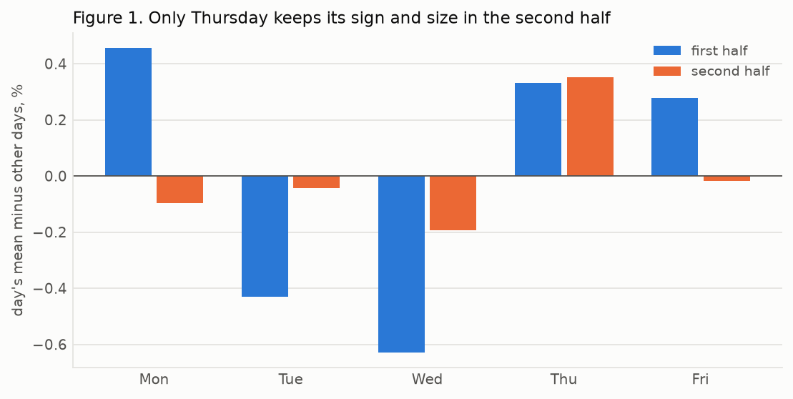
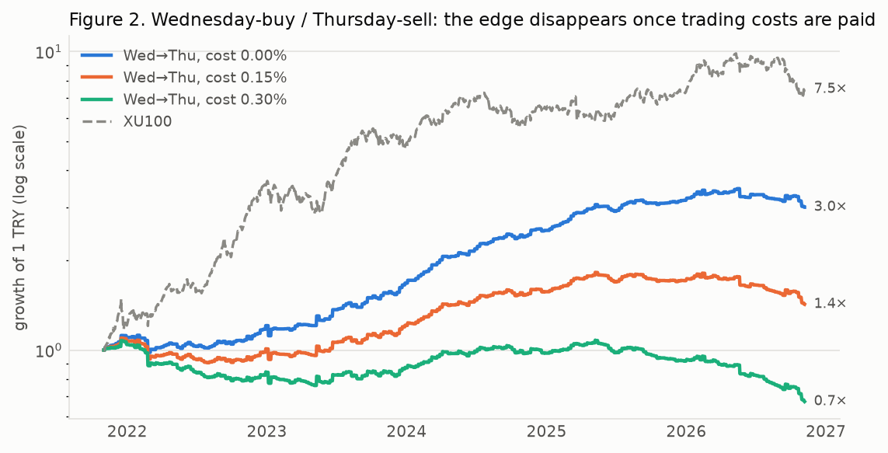

# Report 3 — Weekday and Multi-Day Patterns

_Educational research output for CSE-481. Historical evidence only: not a forecast, not investment advice. Returns are nominal TRY._

Generated by `python -m src.reports.build_reports --only 3` from committed outputs plus the cached price data.

| file | size | sha256 |
|:---|:---|:---|
| `reports/weekday_portfolio.csv` | 1 kB | 3b3440895e8c |
| `reports/weekday_per_stock.csv` | 14 kB | e88fc91d9e19 |
| `reports/streak_patterns.csv` | 3 kB | 3593f75ce389 |
| `reports/macro_panel.csv` | 159 kB | 160ca8d8d783 |
| `config/policy_meetings.csv` | 12 kB | af10f25a02d9 |

## 1. Research question

Project spec §12: do the 30 stocks, or the market they form, show **recurring day-of-week or multi-day
sequences**, and do those patterns survive regimes, unseen later periods, comparison with random labels,
transaction costs and multiple testing? The spec's warning is the point of the exercise: searching many
combinations will produce patterns by chance.

**Short answer.** A few calendar effects are statistically real in this sample but none of them is a usable
trading rule.

- **Wednesdays were weak and Thursdays strong** for the 30-stock portfolio.
  - Wednesday's weakness survives even when all 243 tests in this report are corrected together.
  - Thursday's strength is the only weekday effect that keeps its size in the second half.
  - Part of the Thursday effect comes from central-bank decisions. With the official meeting calendars, the
    clearest link is the **Fed**: Thursdays right after an FOMC decision (announced after the Borsa İstanbul close
    on Wednesday) beat other Thursdays by +0.96 pt (q = 0.025, positive in both halves). TCMB decision weeks
    point the same way but are not significant.
- **Every sector shows it.** All ten sector portfolios have a negative Wednesday and a positive Thursday; five
  sector-day cells survive correction, four of them on a Wednesday or Thursday. It is one market-wide effect, not ten sector patterns.
- **Trading it does not pay.** Buying on Wednesday and selling on Thursday would have earned +201% before costs,
  only +42% with a 0.15% one-way cost, and lost money at 0.30%. XU100 rose 647% over the same five years.
- **The multi-day patterns go the "wrong" way.** Classic reversal ideas ("three down days, then a rebound",
  "buy after a big drop") do not appear. Large down days are followed by *further* underperformance (−1.35 pt in
  5 days), and a rising Friday tends to be followed by a rising Monday. Short-term moves in BIST tend to
  **continue**, not reverse.
- **Most single-stock weekday "patterns" are noise.** 44 of 150 tests have p < 0.05, against 7.5 expected by
  chance. That excess is mostly the common Wednesday/Thursday effect, and only 6 survive correction.

## 2. Data and method

- Daily close-to-close returns of the 30 study stocks, 2021-11-02 – 2026-11-06. "Portfolio" = the
  equal-weight average of the 30 stocks on each day.
- **Valid days only**: a day directly after a holiday (or a Monday after a long weekend) is excluded, because its
  return covers more than one trading session. The earthquake closure (Feb 2023) is excluded.
  1213 of 1258 days are valid.
- Weekday tests compare one weekday with all other weekdays (Welch t-test). A **permutation test** reshuffles the
  weekday labels 5,000 times: how often does a random "weekday" look as extreme?
- Multi-day patterns are measured as **abnormal return**: the stock's next-h-day return minus the average of all
  30 stocks over the same days. Market moves are removed, and each date counts once.
- First half / second half split at **2024-05-06**.
- Every p-value in this report (portfolio, 150 per-stock, 18 streak, 6 new patterns, 1 PPK test) is corrected
  together with Benjamini–Hochberg (Section 8).

## 3. Day of week (30-stock portfolio)

**Table 1. Portfolio return by weekday (%)**

| day | n | mean % | median % | diff vs other days | t | p | p (permutation) | diff first half | diff second half | mean if XU100 up | mean if XU100 down |
|:---|---:|---:|---:|---:|---:|---:|---:|---:|---:|---:|---:|
| Mon | 240 | 0.341 | 0.351 | +0.173 | 1.23 | 0.2194 | 0.1934 | +0.455 | -0.097 | +0.365 | -0.213 |
| Tue | 245 | 0.013 | -0.025 | -0.236 | -1.97 | 0.0491 | 0.0642 | -0.430 | -0.043 | -0.049 | +0.295 |
| Wed | 241 | -0.127 | 0.025 | -0.410 | -3.23 | 0.0012 | 0.0018 | -0.629 | -0.193 | -0.107 | -0.958 |
| Thu | 243 | 0.476 | 0.551 | +0.343 | 2.70 | 0.0069 | 0.0080 | +0.331 | +0.352 | +0.627 | +0.131 |
| Fri | 244 | 0.306 | 0.409 | +0.130 | 1.05 | 0.2915 | 0.3114 | +0.277 | -0.018 | +0.414 | -0.337 |

**Reading Table 1 and Figure 1.**

- **Wednesday** averages −0.13%, 0.41 pt below the other days (p = 0.001; random relabelling gives
  p = 0.002). But its **median is +0.03%**: the typical Wednesday is flat, and a few very bad Wednesdays create
  the average.
- **Wednesday's weakness is concentrated in falling markets.** With XU100 below its 200-day average, the
  Wednesday mean is −0.96% (only about 14% of the valid days fall in that regime).
- **Thursday** is +0.34 pt above the other days, in both halves (+0.33 and +0.35). It is positive for all
  30 stocks (Table 5), and its median (+0.55%) is even higher than its mean. It is the most robust calendar
  observation in this report.
- **Monday, Tuesday and Friday** effects from the first half disappear in the second half, the typical fate
  of a calendar pattern.

### 3.1 Thursdays and central-bank decisions

All 26 policy-rate changes in our TCMB data fall on a Thursday (26 of
26): the Monetary Policy Committee announces its decision on Thursdays at 14:00.

**Table 2. Thursday returns with and without a rate change (%)**

| group | n | mean % |
|:---|---:|---:|
| Thursdays with a policy-rate change | 25 | +1.285 |
| other Thursdays | 218 | +0.383 |
| all non-Thursdays | 970 | +0.133 |

Other Thursdays vs all non-Thursdays: t = 1.93, p = 0.054.
Rate-change Thursdays vs other Thursdays: t = 2.21, p = 0.027.

TCMB's Monetary Policy Committee announces rate decisions on Thursdays. In our macro data, every policy-rate change
falls on a Thursday.

- **Rate-change Thursdays** averaged +1.29% (n = 25), against +0.38% for other Thursdays.
  - Hikes: +1.71%, n = 10.
  - Cuts: +0.95%, n = 16.
  - Both are positive. That suggests a relief effect: uncertainty is resolved on decision day, whatever the
    direction.
- **Without decision days** the Thursday premium shrinks from +0.34 to about +0.25 pt and is no longer
  significant (p = 0.054).
- **Fed decisions** are also announced on Wednesday evening (Türkiye time), after BIST closes, so BIST
  reacts on Thursday. Fed rate changes in our data are therefore also dated on Thursdays.

**Caveat:** our macro data only shows meetings where the rate *changed*. Meetings that held the rate are
invisible there, so "other Thursdays" still contains some decision days. Section 6b repeats the test with the
official TCMB and Fed meeting calendars, including hold decisions.

## 4. Day of week, stock by stock

**Table 3. 150 tests (30 stocks × 5 days)**

| tests | raw p < 0.05 | expected by chance | BH q < 0.05 | Bonferroni p < 0.05 |
|---:|---:|---:|---:|---:|
| 150 | 44 | 7.5 | 6 | 2 |

**Table 4. Strongest single-stock results**

| ticker | day | diff vs other days % | t | p | q BH (150 tests) | p Bonferroni |
|:---|:---|---:|---:|---:|---:|---:|
| ARCLK | Thu | +0.689 | 3.80 | 0.0001 | 0.020 | 0.022 |
| EREGL | Wed | -0.649 | -3.65 | 0.0003 | 0.020 | 0.040 |
| CCOLA | Fri | +0.569 | 3.33 | 0.0009 | 0.036 | 0.129 |
| CCOLA | Wed | -0.541 | -3.25 | 0.0012 | 0.036 | 0.175 |
| ECILC | Fri | +0.712 | 3.24 | 0.0012 | 0.036 | 0.178 |
| KRDMD | Wed | -0.666 | -3.13 | 0.0017 | 0.043 | 0.260 |
| TRALT | Wed | -0.712 | -2.97 | 0.0030 | 0.064 | 0.450 |
| PETKM | Wed | -0.577 | -2.91 | 0.0036 | 0.068 | 0.542 |

**Table 5. The same weekday helps some stocks and hurts others**

| day | strongest stock | weakest stock | stocks above 0 |
|:---|:---|:---|---:|
| Mon | AKBNK (+0.60) | MPARK (-0.34) | 22 |
| Tue | BIMAS (+0.06) | GUBRF (-0.56) | 1 |
| Wed | BIMAS (-0.02) | TRALT (-0.71) | 0 |
| Thu | ARCLK (+0.69) | MGROS (+0.05) | 30 |
| Fri | ECILC (+0.71) | TCELL (-0.40) | 20 |

Table 3 is the clearest multiple-testing lesson in the project:

- **Raw test:** 44 of 150 stock × weekday tests have p < 0.05, far above the 7.5 expected by chance.
- **After correction:** only 6 survive Benjamini–Hochberg and 2 survive Bonferroni (ARCLK Thursday, EREGL
  Wednesday).

The excess is mostly *not* stock-specific. Table 5 shows that Wednesday is negative and Thursday positive for
nearly all 30 stocks, so the per-stock tests mostly rediscover the same market-wide effect 30 times. The spec's
"a second stock may show the opposite pattern" is true on Monday (AKBNK +0.60 vs MPARK −0.34) and Friday (ECILC +0.71
vs TCELL −0.40). On those days the portfolio effect is weak and stock-level differences are what is left: likely
noise, since none of them keeps its sign in both halves at the portfolio level.

## 5. Streaks: consecutive up or down days

**Table 6. Abnormal return after k consecutive down/up days (% vs same-day 30-stock average)**

| pattern | h | n_events | n_dates | mean % | t | p | first half % | second half % | q (18 tests) | q (all tests) |
|:---|---:|---:|---:|---:|---:|---:|---:|---:|---:|---:|
| down2 | 1 | 4,301 | 913 | -0.103 | -2.11 | 0.035 | -0.205 | -0.006 | 0.494 | 0.137 |
| down2 | 3 | 4,300 | 912 | -0.016 | -0.19 | 0.852 | -0.199 | +0.159 | 0.980 | 0.912 |
| down2 | 5 | 4,300 | 912 | -0.134 | -1.22 | 0.222 | -0.322 | +0.044 | 0.571 | 0.370 |
| down3 | 1 | 2,032 | 622 | -0.005 | -0.08 | 0.933 | +0.049 | -0.054 | 0.980 | 0.961 |
| down3 | 3 | 2,031 | 621 | -0.055 | -0.52 | 0.600 | -0.014 | -0.093 | 0.930 | 0.704 |
| down3 | 5 | 2,031 | 621 | -0.130 | -0.93 | 0.353 | -0.036 | -0.215 | 0.794 | 0.496 |
| down4 | 1 | 861 | 387 | -0.046 | -0.50 | 0.620 | -0.091 | -0.010 | 0.930 | 0.724 |
| down4 | 3 | 861 | 387 | +0.014 | 0.08 | 0.933 | +0.174 | -0.115 | 0.980 | 0.961 |
| down4 | 5 | 861 | 387 | -0.006 | -0.03 | 0.980 | +0.110 | -0.099 | 0.980 | 0.988 |
| up2 | 1 | 4,651 | 910 | +0.007 | 0.14 | 0.892 | -0.038 | +0.051 | 0.980 | 0.938 |
| up2 | 3 | 4,646 | 908 | -0.135 | -1.49 | 0.136 | -0.204 | -0.067 | 0.494 | 0.269 |
| up2 | 5 | 4,626 | 907 | -0.179 | -1.49 | 0.137 | -0.213 | -0.145 | 0.494 | 0.269 |
| up3 | 1 | 2,426 | 693 | -0.058 | -0.82 | 0.412 | -0.085 | -0.031 | 0.825 | 0.553 |
| up3 | 3 | 2,405 | 691 | -0.173 | -1.26 | 0.209 | -0.186 | -0.159 | 0.571 | 0.356 |
| up3 | 5 | 2,405 | 691 | -0.295 | -1.81 | 0.071 | -0.457 | -0.127 | 0.494 | 0.191 |
| up4 | 1 | 1,120 | 468 | -0.036 | -0.37 | 0.710 | +0.082 | -0.166 | 0.980 | 0.795 |
| up4 | 3 | 1,111 | 467 | -0.126 | -0.74 | 0.458 | -0.089 | -0.168 | 0.825 | 0.585 |
| up4 | 5 | 1,111 | 467 | -0.333 | -1.62 | 0.104 | -0.370 | -0.291 | 0.494 | 0.225 |

None of the 18 streak tests survives correction (lowest q = 0.15).

- **After up-streaks:** the point estimates are mostly negative (up3 at 5 days: −0.29 pt, up4: −0.33 pt), a mild
  hint that stocks that rose several days in a row lag the average afterwards.
- **After down-streaks:** close to zero.
- **Consistency:** the first half and second half often disagree in sign (down2, down3 and down4 at 3 days).

## 6. Patterns named in the spec

**Table 7. Large down days, three-down-day rebound, the Mon–Wed sequence and Friday → Monday**

| pattern | events | dates/weeks | effect % | t | p | q (all tests) |
|:---|---:|---:|---:|---:|---:|---:|
| stock-day ≤ −5% (not limit) → next 1d vs same-day average | 780 | 306 | -0.409 | -2.91 | 0.0036 | 0.049 |
| stock-day ≤ −5% (not limit) → next 3d vs same-day average | 780 | 305 | -0.735 | -2.88 | 0.0040 | 0.051 |
| stock-day ≤ −5% (not limit) → next 5d vs same-day average | 780 | 305 | -1.345 | -4.62 | 0.0000 | 0.001 |
| 3 down days in a row → next 2d vs same-day average | 2,040 | 624 | +0.047 | 0.55 | 0.5856 | 0.694 |
| Mon, Tue, Wed all negative → Thu+Fri (vs other weeks) | 28 | 28 | +0.959 | 1.58 | 0.1138 | 0.234 |
| next Monday after an up Friday minus after a down Friday | 235 | 235 | +1.115 | 4.27 | 0.0000 | 0.002 |

The spec asks about specific patterns. Their results:

- **"Post-large-down-day mean reversion."** The opposite holds. A stock that falls 5–9.5% in a day (excluding
  limit-down days) underperforms the other 29 stocks by 0.41 pt the next day and **1.35 pt over 5 days**
  (t = −4.6, q = 0.001). A big drop usually carries information (news, selling pressure) that is not fully priced
  in one day.
- **"Three consecutive down days followed by a two-day rebound."** No effect: +0.05 pt, p = 0.59.
- **"Mon–Wed negative, then Thu–Fri positive"** (the THYAO illustration). After such weeks, Thursday+Friday was
  +0.96 pt better than in other weeks. This happened only **28 times** in five years and is not significant
  (p = 0.11). A pattern with 28 occurrences cannot carry a strategy.
- **"End-of-week continuation vs reversal."** Continuation. Monday after a rising Friday is 1.12 pt better than
  Monday after a falling Friday (q = 0.002). News and sentiment over the weekend tend to extend Friday's
  direction.

## 6b. Sectors, sector direction and macro-event weeks (pre-registered)

The spec asks for patterns in **sectors** and **conditional on sector direction or macro-event weeks**. These
tests were written on 22 November 2026, before their results were computed, and join the report's single
Benjamini–Hochberg family.

- **Sector portfolios.** Ten equal-weight sector portfolios (all universe members of the sector), each weekday vs
  the other days of the same portfolio: 50 tests.
- **Sector direction.** The two portfolio findings of Section 3 (weak Wednesday, strong Thursday), computed
  separately on stock-days whose sector rose / fell over the previous five trading days (known before the day):
  4 tests.
- **Macro-event weeks.** Weeks with a TCMB rate decision (announced 14:00, same day), a Fed FOMC decision (announced
  after the Borsa İstanbul close, so the next trading day counts) or a CPI release (TÜİK, the 3rd of the month).
  The meeting dates, including meetings without a rate change, are in `config/policy_meetings.csv` with the
  official source of each: TCMB decision week 54, Fed decision week 41, CPI release week 61 weeks. For each type:
  Wednesday and Thursday in these weeks vs the same day in other weeks, and the whole-week return: 9 tests.

**Table 7a. Sector portfolios: weekday minus other days (%, mean daily return)**

| sector | Mon | Tue | Wed | Thu | Fri |
|:---|---:|---:|---:|---:|---:|
| Automotive & Durables | +0.078 | -0.134 | -0.426 | +0.544 | -0.063 |
| Banking | +0.414 | -0.127 | -0.263 | +0.130 | -0.150 |
| Chemicals & Energy | +0.306 | -0.342 | -0.387 | +0.323 | +0.102 |
| Construction RE & Utilities | +0.149 | -0.232 | -0.429 | +0.258 | +0.253 |
| Healthcare | -0.339 | -0.181 | -0.496 | +0.435 | +0.575 |
| Metals & Mining | +0.348 | -0.293 | -0.675 | +0.422 | +0.199 |
| Other Financials | +0.130 | -0.204 | -0.402 | +0.358 | +0.117 |
| Retail & Consumer | +0.064 | -0.215 | -0.281 | +0.231 | +0.200 |
| Tech Telecom & Defense | +0.295 | -0.230 | -0.292 | +0.358 | -0.128 |
| Transportation | +0.189 | -0.236 | -0.279 | +0.257 | +0.070 |

Sector-day cells with p < 0.05 (before correction):

| sector | day | diff vs other days % | p | q (all tests) |
|:---|:---|---:|---:|---:|
| Metals & Mining | Wed | -0.675 | 0.0001 | 0.007 |
| Healthcare | Fri | +0.575 | 0.0002 | 0.010 |
| Automotive & Durables | Thu | +0.544 | 0.0003 | 0.011 |
| Healthcare | Wed | -0.496 | 0.0020 | 0.035 |
| Construction RE & Utilities | Wed | -0.429 | 0.0030 | 0.046 |
| Automotive & Durables | Wed | -0.426 | 0.0044 | 0.053 |
| Other Financials | Wed | -0.402 | 0.0082 | 0.071 |
| Healthcare | Thu | +0.435 | 0.0095 | 0.073 |
| Chemicals & Energy | Wed | -0.387 | 0.0141 | 0.086 |
| Metals & Mining | Thu | +0.422 | 0.0148 | 0.088 |
| Other Financials | Thu | +0.358 | 0.0178 | 0.092 |
| Chemicals & Energy | Tue | -0.342 | 0.0256 | 0.119 |
| Tech Telecom & Defense | Thu | +0.358 | 0.0260 | 0.119 |
| Chemicals & Energy | Thu | +0.323 | 0.0357 | 0.137 |
| Retail & Consumer | Wed | -0.281 | 0.0361 | 0.137 |
| Healthcare | Mon | -0.339 | 0.0426 | 0.152 |

**Table 7b. Wednesday and Thursday by the sector's direction over the previous five days**

| condition | day | days | diff vs other days % | t | p | q (all tests) |
|:---|:---|---:|---:|---:|---:|---:|
| sector up in previous 5 days | Wed | 218 | -0.297 | -2.26 | 0.0239 | 0.116 |
| sector up in previous 5 days | Thu | 221 | +0.296 | 2.19 | 0.0284 | 0.119 |
| sector down in previous 5 days | Wed | 194 | -0.397 | -2.59 | 0.0096 | 0.073 |
| sector down in previous 5 days | Thu | 199 | +0.402 | 2.63 | 0.0085 | 0.071 |

**Table 7c. Macro-event weeks**

| week type | test | n | effect % | t | p | q (all tests) |
|:---|:---|---:|---:|---:|---:|---:|
| TCMB decision week | Wed in these weeks vs other weeks | 52 | +0.050 | 0.16 | 0.8733 | 0.923 |
| TCMB decision week | Thu in these weeks vs other weeks | 52 | +0.389 | 1.45 | 0.1464 | 0.278 |
| TCMB decision week | whole-week return vs other weeks | 53 | +0.708 | 1.06 | 0.2911 | 0.435 |
| Fed decision week | Wed in these weeks vs other weeks | 38 | -0.495 | -1.31 | 0.1918 | 0.331 |
| Fed decision week | Thu in these weeks vs other weeks | 37 | +0.963 | 3.31 | 0.0009 | 0.025 |
| Fed decision week | whole-week return vs other weeks | 41 | -0.544 | -0.76 | 0.4469 | 0.575 |
| CPI release week | Wed in these weeks vs other weeks | 57 | +0.376 | 1.38 | 0.1675 | 0.302 |
| CPI release week | Thu in these weeks vs other weeks | 58 | +0.087 | 0.35 | 0.7252 | 0.803 |
| CPI release week | whole-week return vs other weeks | 61 | +1.539 | 2.50 | 0.0124 | 0.082 |

- **Sectors (Table 7a).** Wednesday is negative and Thursday positive in **all ten** sectors. The cells that
  survive correction (Metals & Mining, Healthcare and Construction & Utilities on Wednesday, Automotive & Durables
  on Thursday, Healthcare on Friday) are mostly the same market-wide effect. The
  Healthcare Friday (+0.58 pt) comes from two stocks only (MPARK, ECILC) and is the one sector-specific cell.
- **Sector direction (Table 7b).** The pattern does not depend on it: Wednesday −0.30 / −0.40 pt and Thursday
  +0.30 / +0.40 pt after a rising / falling sector week. It is slightly larger after a falling week, but none of
  the four tests survives correction on its own.
- **Macro-event weeks (Table 7c).**
  - **Fed decision weeks:** the Thursday after the FOMC announcement beat other Thursdays by **+0.96 pt**
    (q = 0.025), +1.26 and +0.64 in the two halves, and +0.81 when the ten weeks that also had a TCMB decision are
    removed. The Fed announces after the Borsa İstanbul close on Wednesday, so Thursday is the first day BIST can
    react.
  - **TCMB decision weeks:** Thursday +0.39 pt, not significant. With hold decisions included, the strong
    rate-change Thursdays of Section 3 are diluted.
  - **CPI weeks:** the whole week is +1.5 pt better than other weeks (p = 0.012), but it does not survive
    correction (q = 0.082).
  - So the "central-bank Thursday" of Section 3 is at least as much a Fed reaction as a TCMB one.

## 7. Transaction costs: trading the best calendar pattern

The strongest weekday result is Wednesday-weak / Thursday-strong. The simplest way to trade it: buy all 30
stocks equally at Wednesday's close and sell at Thursday's close, every week (signal shifted one day, Step 9 engine).

**Table 8. Wednesday-buy / Thursday-sell backtest**

| one-way cost % | total return % | XU100 % | Sharpe | max drawdown % | days in market % | trades | total cost (sum of daily %) |
|---:|---:|---:|---:|---:|---:|---:|---:|
| 0.00 | 201 | 647 | 1.79 | -13 | 20 | 7,500 | 0 |
| 0.15 | 42 | 647 | 0.62 | -22 | 20 | 7,500 | 75 |
| 0.30 | -33 | 647 | -0.56 | -38 | 20 | 7,500 | 150 |

This is the "prediction ≠ profitable strategy" lesson in one table.

- **Before costs:** the Wednesday-buy / Thursday-sell rule is in the market only 20% of the days and still
  triples the money (Sharpe 1.79).
- **With costs:** every week it buys and sells the whole portfolio, 7,500 position entries in five years. A
  0.15% one-way cost removes most of the return (+42%) and 0.30% turns it into a loss (−33%).
- **Against holding XU100:** XU100 grew 7.5× over the same period.
- **Cash earns nothing in the backtest.** The engine gives 0% on the 80% of days out of the market. In reality
  TRY cash earned high interest in 2023–2026, which would help the rule, but the comparison with XU100 would
  still fail.

A statistically significant weekday difference is a fact about averages, not a trade.

## 8. Multiple testing

**Table 9. How many tests were run and how many survive**

| family | tests | raw p < 0.05 | q < 0.05 (all tests together) |
|:---|---:|---:|---:|
| weekday (portfolio) | 5 | 3 | 1 |
| weekday (per stock) | 150 | 44 | 8 |
| streaks | 18 | 1 | 0 |
| new patterns | 6 | 4 | 3 |
| PPK Thursdays | 1 | 0 | 0 |
| sector portfolios (pre-registered) | 50 | 16 | 5 |
| sector direction (pre-registered) | 4 | 4 | 0 |
| macro-event weeks (pre-registered) | 9 | 2 | 1 |

**Table 10. Results with q < 0.05 after correcting all 243 tests together**

| family | test | p | q (all tests) |
|:---|:---|---:|---:|
| new patterns | stock-day ≤ −5% (not limit) → next 5d vs same-day average | 0.00000 | 0.001 |
| new patterns | next Monday after an up Friday minus after a down Friday | 0.00002 | 0.002 |
| sector portfolios (pre-registered) | Metals & Mining Wed | 0.00008 | 0.007 |
| weekday (per stock) | ARCLK Thu | 0.00014 | 0.009 |
| sector portfolios (pre-registered) | Healthcare Fri | 0.00021 | 0.010 |
| weekday (per stock) | EREGL Wed | 0.00027 | 0.011 |
| sector portfolios (pre-registered) | Automotive & Durables Thu | 0.00033 | 0.011 |
| weekday (per stock) | CCOLA Fri | 0.00086 | 0.025 |
| macro-event weeks (pre-registered) | Fed decision week / Thu in these weeks vs other weeks | 0.00095 | 0.025 |
| weekday (per stock) | CCOLA Wed | 0.00116 | 0.025 |
| weekday (per stock) | ECILC Fri | 0.00119 | 0.025 |
| weekday (portfolio) | Wed | 0.00124 | 0.025 |
| weekday (per stock) | KRDMD Wed | 0.00173 | 0.032 |
| sector portfolios (pre-registered) | Healthcare Wed | 0.00199 | 0.035 |
| weekday (per stock) | TRALT Wed | 0.00300 | 0.046 |
| sector portfolios (pre-registered) | Construction RE & Utilities Wed | 0.00302 | 0.046 |
| new patterns | stock-day ≤ −5% (not limit) → next 1d vs same-day average | 0.00357 | 0.049 |
| weekday (per stock) | PETKM Wed | 0.00362 | 0.049 |

- **Tests run.** 243 tests (Table 9): the 180 of the original analysis and 63 pre-registered on 22 November
  (sector portfolios, sector direction, macro-event weeks). 74 had raw p < 0.05.
- **Correction.** After correcting all of them together, **18 survive**:
  - the nine survivors of the original 180 tests, all still below 0.05: the portfolio Wednesday effect, six
    single-stock weekday effects (mostly the same Wednesday/Thursday effect), the large-down-day continuation at
    5 days and the Friday → Monday continuation;
  - five sector-day cells and the Fed-week Thursday (pre-registered);
  - three borderline original tests (TRALT and PETKM Wednesday, the large-down-day continuation at 1 day,
    q = 0.046–0.049). They crossed 0.05 only because the family grew: adding tests with small p-values loosens
    the Benjamini–Hochberg thresholds. With the original 180 tests they did not survive, so we do not count them
    as findings.
- **Thursday.** The portfolio Thursday effect (p = 0.007) does *not* survive when everything is corrected
  together, even though it is the most stable over time.

Significance after correction and stability over time are different questions, and a pattern needs both before
it is taken seriously. Only Wednesday (weaker in the second half) comes close.

## 9. Türkiye context

- **Central-bank Thursdays.** TCMB rate decisions (Thursday 14:00) and Fed decisions (announced after BIST's
  close on Wednesday) both land on Thursday trading. 2023–2024 had an unusually long series of large TCMB moves:
  hikes from 8.5% to 50% between June 2023 and March 2024, then cuts from December 2024. This explains why
  decision Thursdays matter so much in this sample.
- **High-inflation drift.** With strong nominal market growth, every weekday has a positive median except
  Tuesday. Weekday tests compare days *with each other*, so the drift cancels out, but it is one reason the
  Wednesday-buy rule loses so badly to simply holding the index.
- **Stress periods.** Wednesday's weakness is concentrated in XU100-down regimes: late 2024, March–June 2025
  and September–November 2026 (Report 1). Some of the worst Wednesdays fall in these sell-offs. We did not
  test this day by day, so the link is an observation, not a cause.

Verified from our data: the weekday of every policy-rate change. From general knowledge: the TCMB rate path and
the TCMB and Fed announcement times.

## 10. How the harness uses these results

The MCP tool `test_weekday_pattern` lets an agent test a weekday or streak pattern for one stock. It returns
the Welch t-test, the first-half vs second-half consistency and a cost note. Calendar patterns are **not** used to
choose any harness action. Given this report, that is deliberate:

- most patterns disappear out of sample;
- the strongest ones are market-wide calendar effects tied to policy days;
- even the best one does not survive trading costs.

If an agent finds a "pattern" for one stock, the harness treats it as context that needs the multiple-testing
warning, not as evidence for a candidate label.

## 11. Limitations

- **Five years, one market.** About 240 observations per weekday. Weekday effects are known to come and go
  across decades.
- **Calendar of events.** TCMB and Fed meetings come from the official calendars (`config/policy_meetings.csv`;
  TCMB November–December 2021 from our EVDS rate changes because the official 2021 page did not load). CPI
  release weeks use TÜİK's rule (3rd of the month), not a checked release calendar. Options/futures expiry days
  were not tested.
- **Sector portfolios overlap with the 30-stock portfolio**, so the sector results are not independent of the
  portfolio Wednesday/Thursday effect.
- **Normal approximation.** Welch tests use it, but the permutation p-values agree closely, so this does not
  change conclusions.
- **Simplified backtest.** No interest on cash, a fixed cost, and no market-impact or bid-ask modelling for the
  open/close.

## 12. Conclusion

Calendar patterns are where data mining is easiest. In this sample:

- Wednesday-weak / Thursday-strong is the one weekday effect worth mentioning. It appears in every sector, is
  partly explained by central-bank decisions (most clearly the first trading day after a Fed decision) and is
  not tradable after costs.
- Single-stock weekday patterns are mostly the same market effect repeated, plus noise.
- Short-term multi-day behaviour is continuation, not the reversal the classic patterns assume.

The project treats these results as **descriptive context only**: none of them is allowed to drive an action label
in the harness.
