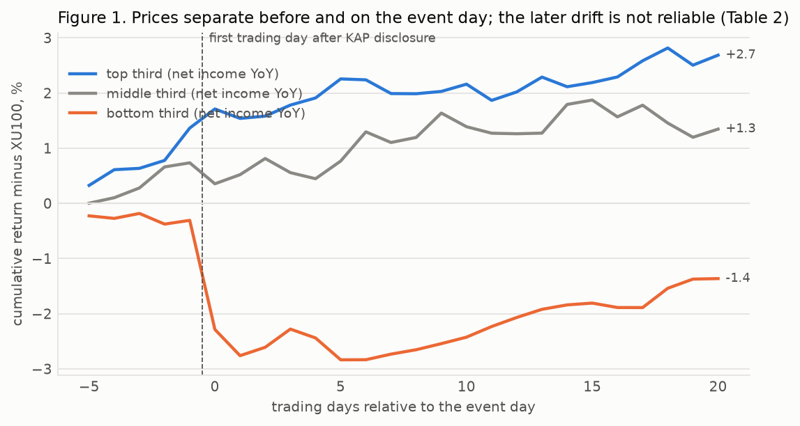

# Report 4 — Quarterly Fundamentals and Post-Disclosure Price Reaction

_Educational research output for CSE-481. Historical evidence only: not a forecast, not investment advice. Returns are nominal TRY._

Generated by `python -m src.reports.build_reports --only 4` from committed outputs, Fintables statements and the
cached price data.

| file | size | sha256 |
|:---|:---|:---|
| `reports/earnings_events.parquet` | 218 kB | 1b0b994a4a23 |
| `reports/earnings_by_tercile.csv` | 1 kB | d4d8756745ae |
| `reports/earnings_spread_tests.csv` | 1 kB | 6d7116e4fb14 |
| `reports/earnings_spread_by_quarter.csv` | 2 kB | 61e25e9250de |
| `reports/kap_disclosure_dates.csv` | 47 kB | 5db5d94e364e |
| `reports/disclosure_spike_check.csv` | 0 kB | afcb4d80c487 |

## 1. Research question

Project spec §9 and §14: align quarterly financial statements with the moment they became **public**, then ask
whether specific changes (profit, revenue, operating profit, margins, ROE) were historically associated with
**different price reactions**: before, on and after the disclosure, against XU100 and against the sector's peers.
The question is not "good earnings = price rises".

**Short answer.** The market reacts to quarterly results, and it reacts to *profitability*, not to sales.

- **Net-income ranking.** Companies in the top third by year-over-year net-income change beat those in the bottom
  third by **+2.0 pt on the event day** and +2.4 pt over days 0–1 (q = 0.021 and 0.029 after correcting all 22
  tests of this report). Each company's third is decided with information that was public on its own event day.
- **Which metrics matter.** Operating-income growth and net-margin change separate winners from losers on the event
  day as clearly as net income does, in both halves of the sample. Revenue growth, which in high-inflation Türkiye
  is mostly price increases, does not.
- **No reliable move before the filing.** Top-third companies rise before they report, but the pre-event spread is
  not significant after correction (q = 0.11 across all 22 tests) and its size depends on the ranking method. An earlier version of
  this report found it significant; that result relied on figures that were not yet public (Section 2).
- **Drift.** Net income shows no drift after the first days (days 1–20: +0.2 pt, p = 0.92). The one exception is
  the **net-margin change**: +5.1 pt over days 1–20, positive in both halves (q = 0.046). It is the most interesting
  result for future work.
- **Mostly company-specific.** Against sector peers instead of XU100, the event-day and days 0–4 spreads also
  survive correction (+1.75 and +2.22 pt).

## 2. Data and point-in-time alignment

- **Statements.** Fintables quarterly income statements and balance sheets for the 30 stocks (Step 2), 2022Q1 –
  2026Q3. Banks and other financials (AKBNK, ISMEN, TURSG) have no revenue/operating-profit lines, so
  industrial ratios are computed only for non-financial companies.
- **Disclosure time.** The real KAP publication timestamp of each statement (Step 7B, 545 filings). The
  median filing comes 39 days after the quarter end, and **88%
  are published after 18:00**, after the market closes. The **event day** is therefore the first trading day *after*
  publication, the first day the market could react.
- **Legal deadlines are not enough.** 15% of filings came after the standard
  deadline, mostly 2023Q4 – 2024Q2 (the first inflation-accounting statements, when SPK extended deadlines). Using
  deadlines instead of real dates would have put information into the wrong days.
- **Events.** 545 disclosures. 11 have no event day in the price data,
  3 fall in the earthquake window, leaving **531**.
- **Figures as known on the event day.** Fintables keeps the latest version of every figure. For the 24
  companies that apply inflation accounting (TMS 29) it re-states 2022Q4 – 2023Q3 and re-expresses all later
  figures in the money of the latest balance-sheet month (checked against 20 published figures). The restated
  2022Q4 – 2023Q3 figures were first published a year later, so these quarters carry no fundamentals on their own
  event day; they are used only as comparatives in the next year's reports. Year-over-year changes always compare
  two figures in the same unit (`src/data/pit_fundamentals.py`, Data Dictionary).
- **Ranking without look-ahead.** A company's third is decided with information available on its own event day:
  its year-over-year net-income change is compared with the 1/3 and 2/3 points of the **previous quarter's**
  changes, using only previous-quarter figures already published (at least 15). Ranking against all companies of
  the same quarter, as an earlier version of this report did, used the results of companies that reported weeks
  later. 381 of 531 events are ranked. Quarters without enough comparable previous-quarter
  figures (2023Q1 – 2024Q1, around the TMS 29 switch) are not ranked. Section 4 compares this with ranking among
  the companies that had already reported in the same quarter.
- **Returns.** Abnormal return = stock return − XU100 return over the window, and separately stock return − the
  equal-weight return of its sector peers. Windows are in trading days, with the event day = 0.
- **Statistics.** Each quarter's top-minus-bottom spread is one observation (13 quarters with at least 15 ranked
  events), because stocks in the same quarter are not independent. All 22 tests in this report share one
  Benjamini–Hochberg correction.

## 3. Main result: reaction by net-income ranking

**Table 1. Mean abnormal return vs XU100 by net-income YoY third (%)**

| tercile | n | 5 days before % | event day % | days 0–4 % | days 1–20 % | event-day hit % |
|:---|---:|---:|---:|---:|---:|---:|
| bottom | 133 | -0.23 | -1.75 | -2.14 | 0.94 | 26.3 |
| middle | 114 | 0.75 | -0.35 | -0.31 | 0.92 | 43.0 |
| top | 134 | 1.36 | 0.28 | 0.45 | 0.68 | 53.7 |
| any stock-day (baseline) | – | 0.18 | 0.03 | 0.18 | 0.76 | – |

**Table 2. Top-minus-bottom spread, one observation per quarter (pt vs XU100)**

| window | quarters | top − bottom (pt) | t | p | positive quarters | first half | second half | q (6 windows) | p Bonferroni |
|:---|---:|---:|---:|---:|---:|---:|---:|---:|---:|
| 5 days before | 13 | 1.26 | 2.11 | 0.0567 | 11 | 2.80 | -0.07 | 0.085 | 0.340 |
| event day | 13 | 2.01 | 3.72 | 0.0029 | 11 | 2.58 | 1.53 | 0.016 | 0.017 |
| days 0–1 | 13 | 2.40 | 3.39 | 0.0053 | 10 | 3.41 | 1.54 | 0.016 | 0.032 |
| days 0–4 | 13 | 2.48 | 2.36 | 0.0364 | 10 | 3.72 | 1.41 | 0.073 | 0.218 |
| days 1–5 | 13 | 0.65 | 0.79 | 0.4463 | 9 | 1.62 | -0.18 | 0.536 | 1.000 |
| days 1–20 | 12 | 0.20 | 0.11 | 0.9158 | 7 | -1.40 | 1.80 | 0.916 | 1.000 |

**Reading Table 1, Table 2 and Figure 1.**

- **Before the event.** Top-third companies rise +1.36% above XU100 in the five days before the event day; the
  bottom third is flat (−0.23%). Peers have often reported already and sector data is public, so part of the news
  can be read early. The spread is not significant after correction (p = 0.057; q = 0.085 among the six windows of Table 2), so we report it only as
  an observation. We cannot tell anticipation from leakage with this data.
- **On the event day.** Bottom-third companies fall −1.75% vs XU100 and only 26% of them beat the index. Top-third
  companies are slightly positive (+0.28%, 54% beat the index).
- **Disclosure days are negative on average.** The average event-day return across all events is −0.64% vs the
  index, against a +0.03% baseline; only the top third is positive. We report it as an observation, not a tested
  effect.
- **The spread is concentrated on the event day and the day after** (days 0–1: +2.40 pt, q = 0.016 in Table 2) and is **not
  there afterwards**: days 1–5 +0.65 pt (p = 0.45), days 1–20 +0.20 pt (p = 0.92). Once the information is public it
  is priced within a day or two. A rule that buys after reading the statement is mostly too late.

## 4. Does the result depend on how companies are ranked?

The same top-minus-bottom test with three ways of deciding a company's third. A is used everywhere else in this
report, in the strategies and in the harness. B is the strictest alternative without look-ahead: a company is
ranked only among the companies of the same quarter that had already reported, so early reporters are not ranked.
The old method is shown only to measure what the look-ahead changed. These are three measurements of one
hypothesis, so they are not added to the multiple-testing family.

**Table 2b. Top-minus-bottom spread by ranking method (pt vs XU100, one observation per quarter)**

| method | ranked events (quarters) | 5 days before pt | 5 days before p | event day pt | event day p | days 0–4 pt | days 0–4 p | days 1–20 pt | days 1–20 p |
|:---|:---|---:|---:|---:|---:|---:|---:|---:|---:|
| A: previous quarter's cut-offs (main) | 381 (13) | +1.26 | 0.057 | +2.01 | 0.003 | +2.48 | 0.036 | +0.20 | 0.916 |
| B: same quarter, stocks already reported (robustness) | 229 (13) | +1.51 | 0.181 | +2.01 | 0.020 | +2.49 | 0.077 | -0.42 | 0.805 |
| old: whole quarter, uses later reporters (look-ahead; comparison only) | 408 (14) | +1.33 | 0.053 | +1.54 | 0.010 | +2.04 | 0.043 | +1.10 | 0.459 |

- **The event-day result does not depend on the ranking method.** Ranking against the previous quarter's cut-offs
  (A) and ranking only among companies that had already reported (B) both give +2.01 pt on the event day
  (p = 0.003 and 0.020). B ranks 229 events instead of 381, because early reporters have too few comparisons.
- **The pre-event and 20-day results do depend on it.** The five-day pre-event spread is +1.26 pt (A), +1.51 (B)
  and +1.33 (old), none significant; days 1–20 range from −0.42 to +1.10 pt. These are not findings.
- **What the corrections changed.** The earlier version of this report ranked each company against the whole
  quarter, which used the results of companies that reported weeks later, and it used the inflation-accounting
  restatements of 2023 on their original dates although they were published a year later. It reported +1.67 pt
  before the event (q = 0.030) and +1.39 pt on the event day. The corrected picture is the reverse: a larger
  event-day reaction and no reliable move before it.

## 5. Quarter by quarter

- **Across quarters.** The days 0–4 spread is positive in 10 of 13 quarters and averages +2.48 pt. It is not
  stable.
- **Largest positive quarters.** 2022Q1 and Q2 (+7.4 and +6.8 pt), when nominal profit growth was extreme and the
  dispersion between companies was large, and 2025Q3 (+6.7 pt).
- **Negative quarters.**
  - 2022Q3 (−3.7 pt): results were published in Oct–Nov 2022, during a strong broad rally.
  - 2026Q3 (−2.6 pt): results were published during the Oct–Nov 2026 fund-liquidation sell-off (Report 1). In such
    weeks, market-wide flows dominate company news.
  - 2025Q1 (−1.2 pt).
- **Missing quarters.** 2022Q4 – 2024Q1 are not ranked: around the inflation-accounting switch there are no
  comparable previous-quarter figures (Section 2).
- **Inflation-accounting quarters** (orange, statements under TMS 29) are positive in 8 of 10, with a mean of
  +2.2 pt, close to the full-sample mean. They are not steadier than the nominal quarters of 2022.

## 6. Against sector peers

**Table 3. Mean abnormal return vs the sector peer basket by net-income third (%)**

| tercile | 5 days before % | event day % | days 0–4 % | days 1–20 % |
|:---|---:|---:|---:|---:|
| bottom | 0.18 | -1.53 | -2.00 | -0.13 |
| middle | 0.49 | -0.34 | -0.56 | 0.26 |
| top | 1.59 | 0.22 | 0.06 | -0.20 |

**Table 4. Top-minus-bottom spread vs peers, one observation per quarter**

| window | quarters | top − bottom vs peers (pt) | t | p | q (all tests) |
|:---|---:|---:|---:|---:|---:|
| 5 days before | 13 | 1.13 | 1.54 | 0.1505 | 0.224 |
| event day | 13 | 1.75 | 3.23 | 0.0072 | 0.032 |
| days 0–4 | 13 | 2.22 | 2.75 | 0.0175 | 0.046 |
| days 1–20 | 12 | -0.08 | -0.04 | 0.9662 | 0.966 |

Against sector peers the top-minus-bottom spread **survives correction on the event day (+1.75 pt, q = 0.032) and
over days 0–4 (+2.22 pt, q = 0.046)**, and it is positive in both halves of the sample. The pre-event spread does
not survive (+1.13 pt, q = 0.22).

Peers report in the same weeks, and sector-wide news (a bank-sector margin squeeze, steel prices) moves the whole
group, so part of a "stock reaction" can be a "sector reaction". With that part removed, the reaction is still about
90% of its size against XU100: it is mostly company-specific.

## 7. Which fundamental change does the market react to?

**Table 5. Top-minus-bottom third spread by metric (pt vs XU100, one observation per quarter).** Net income is
in Table 2; it is not repeated here so that it is not counted twice in the multiple-testing correction.

| metric | window | events | quarters | top − bottom (pt) | first half | second half | t | p | q (all tests) |
|:---|:---|---:|---:|---:|---:|---:|---:|---:|---:|
| revenue YoY (non-financial) | event day | 386 | 13 | 0.45 | 1.45 | -0.40 | 0.74 | 0.4706 | 0.609 |
| revenue YoY (non-financial) | days 0–4 | 386 | 13 | 0.92 | 2.61 | -0.53 | 0.62 | 0.5463 | 0.665 |
| revenue YoY (non-financial) | days 1–20 | 386 | 12 | 0.69 | 2.21 | -0.83 | 0.32 | 0.7575 | 0.833 |
| operating income YoY (non-financial) | event day | 386 | 13 | 1.95 | 2.23 | 1.71 | 4.43 | 0.0008 | 0.018 |
| operating income YoY (non-financial) | days 0–4 | 386 | 13 | 1.81 | 2.07 | 1.60 | 1.59 | 0.1389 | 0.224 |
| operating income YoY (non-financial) | days 1–20 | 386 | 12 | -0.90 | -1.96 | 0.15 | -0.58 | 0.5740 | 0.665 |
| net margin change, pt (non-financial) | event day | 386 | 13 | 1.97 | 2.61 | 1.42 | 4.03 | 0.0017 | 0.018 |
| net margin change, pt (non-financial) | days 0–4 | 386 | 13 | 3.57 | 5.45 | 1.95 | 3.12 | 0.0089 | 0.033 |
| net margin change, pt (non-financial) | days 1–20 | 386 | 12 | 5.07 | 5.57 | 4.56 | 2.75 | 0.0187 | 0.046 |
| ROE change, pt | event day | 363 | 9 | 1.79 | 2.36 | 1.33 | 3.06 | 0.0156 | 0.046 |
| ROE change, pt | days 0–4 | 363 | 8 | 2.58 | 2.58 | 2.58 | 1.60 | 0.1527 | 0.224 |
| ROE change, pt | days 1–20 | 363 | 8 | 3.41 | 3.48 | 3.35 | 2.02 | 0.0833 | 0.153 |

**What the market reacts to is profitability, not growth in sales.**

- **Revenue YoY:** event-day spread +0.45 pt (p = 0.47), and the sign flips between halves. In 2022–2024, sales
  growth of 50–100% was mostly inflation, not volume, so it carried little news.
- **Operating income YoY:** +1.95 pt on the event day (q = 0.018), similar in both halves (+2.23 / +1.71).
- **Net margin change:** +1.97 pt on the event day (q = 0.018), +3.57 pt over days 0–4 (q = 0.033) and
  **+5.07 pt over days 1–20** (q = 0.046, +5.57 / +4.56 in the two halves). Margins show whether a company passes
  inflation on to its prices. This is the only post-disclosure drift that survives correction. We did not plan this
  test in advance and it is one of 22, so it is a candidate to re-test on new quarters, not a rule.
- **ROE change:** +1.79 pt on the event day (q = 0.046), but only 9 quarters can be ranked. ROE needs a balance sheet
  and an income statement in the same unit, and for 2023 the inflation-accounting restatements exist only for the
  income statement. The 20-day drift (+3.41 pt, q = 0.15) does not survive. The earlier version of this report
  found a strong ROE drift (q = 0.003); it relied on restated figures that were not yet public.

## 8. Profit direction, losses and financials

The "+48%" for a company whose loss shrank (PETKM, Step 14) showed that a percentage alone can mislead. Here are
the same words the harness now uses (`profit_direction`).

**Table 6. By direction of quarterly net income vs the same quarter a year earlier (%)**

| direction | n | 5 days before % | event day % | days 0–4 % | days 1–20 % | event-day hit % |
|:---|---:|---:|---:|---:|---:|---:|
| profit up | 202 | 1.47 | -0.00 | -0.10 | 1.89 | 47.0 |
| profit down | 125 | -0.13 | -1.27 | -1.95 | 0.03 | 28.8 |
| loss → profit | 41 | 0.72 | -1.04 | 0.43 | 1.15 | 36.6 |
| profit → loss | 39 | -0.14 | -1.57 | -1.14 | -0.06 | 35.9 |
| loss narrowed | 17 | 0.99 | -1.13 | -1.67 | 1.41 | 47.1 |
| loss widened | 11 | -1.45 | -0.71 | 1.24 | 6.17 | 27.3 |

**Table 7. Loss vs profit, financial vs non-financial (%)**

| group | n | 5 days before % | event day % | days 0–4 % | days 1–20 % | event-day hit % |
|:---|---:|---:|---:|---:|---:|---:|
| reported a profit | 368 | 0.84 | -0.55 | -0.66 | 1.19 | 39.7 |
| reported a loss | 67 | -0.07 | -1.31 | -0.90 | 1.22 | 37.3 |
| non-financial | 478 | 0.60 | -0.66 | -0.54 | 0.93 | 39.5 |
| financial (AKBNK, ISMEN, TURSG) | 53 | 1.48 | -0.46 | -0.97 | 2.60 | 35.8 |

- **The worst case is not "profit → loss" but "profit down".** Companies whose profit fell (but stayed positive)
  lose −1.27% on the event day (only 29% beat the index) and −1.95% over days 0–4.
- **Loss → profit and profit → loss** are both negative on the day (−1.04% and −1.57%). Over days 1–20 the first
  recovers (+1.15%), the second does not (−0.06%). With about 40 events each, these are noisy.
- **Small groups.** "Loss narrowed" (n = 17) and "loss widened" (n = 11) are too small to interpret. The +6.17% for
  "loss widened" over days 1–20 comes from 9 events and one +33% rebound; the median is +4.2%.
- **Financials vs others.** The three financials react like the non-financials. Banks are ranked on net income and
  ROE only; revenue, operating-income and margin metrics exclude them.

## 9. Strong fundamentals with weak technicals, and vice versa

The technical state is measured at the close **before** the event day: is the price above its 200-day average?

**Table 8. Net-income third × technical state (abnormal return vs XU100, %)**

| tercile | state | n | event day % | days 0–4 % | days 1–20 % |
|:---|:---|---:|---:|---:|---:|
| bottom | above SMA200 | 61 | -2.25 | -2.38 | 0.71 |
| bottom | below SMA200 | 55 | -0.52 | -0.58 | 1.58 |
| middle | above SMA200 | 64 | -0.56 | -0.96 | 1.76 |
| middle | below SMA200 | 33 | -0.15 | 0.37 | 0.00 |
| top | above SMA200 | 94 | -0.37 | -0.46 | -0.18 |
| top | below SMA200 | 23 | 1.88 | 3.00 | 2.24 |

The spec asks to compare good fundamentals with weak technicals and vice versa. The pattern is consistent with
**surprise relative to expectations**, if the price trend is read as a proxy for expectations:

- **Strong trend, weak earnings** (bottom third, price above its 200-day average, n = 61): the largest event-day
  loss (−2.25%). Investors expected more.
- **Weak trend, weak earnings** (n = 55): only −0.52%. The bad news was already in the price.
- **Weak trend, strong earnings** (top third below its 200-day average, n = 23): the best event-window reaction
  (+3.00% over days 0–4), against −0.46% for top-third companies already in an uptrend (n = 94).

These cells were not tested for significance and the "weak trend, strong earnings" group is small. It is an
interpretation to check on new data. It also shows why the harness never treats strong earnings alone as
sufficient.

## 10. Is there unusual activity in reporting season?

Step 7 compared how often large volume spikes and large abnormal moves happen inside reporting windows vs
outside them (share of stock-days).

**Table 9. Spikes inside vs outside reporting season**

| share of stock-days with | in reporting season | outside season | ratio |
|:---|---:|---:|---:|
| volume z-score > 2 | 0.0334 | 0.0345 | 0.97 |
| volume z-score > 3 | 0.0078 | 0.0071 | 1.11 |
| abs. abnormal return > 4% | 0.0608 | 0.0699 | 0.87 |
| abs. abnormal return > 6% | 0.0186 | 0.0195 | 0.95 |
| both (z > 2 and > 4%) | 0.0135 | 0.0137 | 0.99 |

Reporting season as a whole shows **no more** volume spikes or large abnormal moves than other weeks (ratios
0.87–1.11). The reaction is concentrated on each company's own event day, not spread across the season. This also
argues against widespread pre-announcement trading.

## 11. Multiple testing

22 tests were corrected together; **9** have q < 0.05:

| family | test | p | q (all tests) |
|:---|:---|---:|---:|
| metric spreads | operating income YoY (non-financial) / event day | 0.00083 | 0.018 |
| metric spreads | net margin change, pt (non-financial) / event day | 0.00168 | 0.018 |
| net income spread vs XU100 | event day | 0.00291 | 0.021 |
| net income spread vs XU100 | days 0–1 | 0.00534 | 0.029 |
| net income spread vs peers | event day | 0.00717 | 0.032 |
| metric spreads | net margin change, pt (non-financial) / days 0–4 | 0.00888 | 0.033 |
| metric spreads | ROE change, pt / event day | 0.01561 | 0.046 |
| net income spread vs peers | days 0–4 | 0.01751 | 0.046 |
| metric spreads | net margin change, pt (non-financial) / days 1–20 | 0.01874 | 0.046 |

- **Nine of 22 tests survive.**
  - Four net-income spreads: event day and days 0–1 vs XU100; event day and days 0–4 vs peers.
  - Four event-window spreads of other metrics: operating income and net margin on the event day, net margin over
    days 0–4, ROE change on the event day.
  - One drift: net margin over days 1–20.
- **All nine keep their sign in both halves** of the sample.
- **Not surviving:** the pre-event spread (q = 0.11), the 20-day net-income drift (p = 0.92), the ROE drift and
  revenue.

The pattern of survivors is economically coherent: profitability measures, around the disclosure. That makes it
more believable than a single isolated p-value would be.

## 12. Türkiye context

- **Nominal profits in 2022–2023.** With annual CPI above 50–80%, the median company's net income grew 75–200%
  year over year in nominal TRY. Ranking companies against each other is essential; raw growth rates would mostly
  measure inflation.
- **Inflation accounting (TMS 29) from 2023 year-end.**
  - KGK announced in November 2023 that companies applying TFRS must restate their 31 Dec 2023 statements for
    inflation.
  - SPK confirmed this for listed companies on 28 Dec 2023 and gave **10 extra weeks** for the first annual reports.
  - This is why 60–80% of 2023Q4–2024Q1 filings in our KAP data came after the usual deadline, and why we use real
    KAP timestamps.
  - The 2024Q4 median net-income change in our data is −73%. For a third of the companies the restated 2023Q4 profit
    was more than twice their average 2023 quarter, so the comparison base is unusually high. Against the previous
    quarter's cut-offs, 22 of the 30 companies fall into the bottom third in 2024Q4.
- **How Fintables stores these years.** Fintables keeps the latest version of each figure. It shows the
  restatements of 2022Q4 – 2023Q3 (published a year later, in the next year's reports) instead of the original
  figures, and it re-expresses all later figures in the money of each company's latest balance sheet. We verified
  this against 20 published figures and use each figure only from the day its version became public. This is why
  2022Q4 – 2024Q1 cannot be ranked.
- **Banks were treated differently.** BDDK decided that banks would not restate their 2023 statements. A December
  2025 BDDK decision says banks and other financial institutions will not apply inflation accounting to their
  2025 statements either. AKBNK's figures are therefore not on the same accounting basis as the industrial companies,
  another reason to rank them on net income and ROE only. We did not find a source for the 2024 bank decision.

Verified by search: KGK and SPK TMS 29 announcements and BDDK bank decisions for 2023 and 2025
([KGK duyuru](https://www.kgk.gov.tr/Portalv2Uploads/files/Duyurular/v2/Diger/Y%C3%BCksek%20Enflasyonlu%20Sunum%20Para%20Birimine%20%C3%87evrim%20Duyuru.pdf),
[BloombergHT: SPK](https://www.bloomberght.com/spkdan-enflasyon-muhasebesi-aciklamasi-2344793),
[Sözcü: BDDK](https://www.sozcu.com.tr/bddk-dan-enflasyon-duzeltmesi-aciklamasi-p8411),
[Alomaliye: BDDK 2025](https://www.alomaliye.com/2025/12/23/enflasyon-muhasebesi-uygulamasi-banka-ve-finans-sirketlerinde-kaldirildi/)).
From our own data: the filing delays, the unranked quarters, the median changes and the check of Fintables against
published figures (Data Dictionary, `fundamentals`).

## 13. How the harness uses these results

The harness uses this scenario for `FUNDAMENTAL_IMPROVEMENT_CANDIDATE`. The rule requires:

- the latest **public** statement (event day ≤ analysis date) in the top net-income third, decided against the
  previous quarter's cut-offs;
- not a loss;
- no more than 63 trading days since the event day.

The attached history is the top-minus-bottom spread over days 0–4, computed only from events whose window had
closed before the analysis date. The evidence sentence states the quarter, the two net-income amounts in the money
of that report, the direction in words ("profit up", "loss narrowed", …), the third and its cut-offs.

Given this report, the label means "recent profitability news was strong". It does **not** predict further gains:

- most of the reaction happens on the event day and the day after;
- the label can be up to three months old.

Net-margin improvement, the one metric with a post-disclosure drift, is not used by the harness. Adding it would
need a pre-registered test on new quarters first.

## 14. Limitations

- **No expectations data.** There is no analyst consensus, so "surprise" is approximated by the change vs the
  same quarter last year and by the price trend.
- **EBITDA, leverage, liquidity, cash flow and valuation not analysed yet.** The event table carries the
  statement ratios (EBITDA, operating cash flow and net debt checked against published company figures) and
  `reports/valuation_daily.parquet` carries daily P/E, P/B and EV/EBITDA, but their price reactions are not yet
  tested in this report. An earlier version of this report wrongly said these lines were missing from the data.
- **Low power.** 13 quarters (12 for days 1–20) is a small number of independent observations; 2022Q4 – 2024Q1
  cannot be ranked.
- **Latest versions only.** Fintables carries later corrections back into earlier periods. We found one small case
  (0.1%); larger corrections would not be visible to us.
- **Previous-quarter cut-offs** avoid look-ahead but follow shifts between quarters with a lag (2024Q4). Table 2b
  shows that the event-day result does not depend on this choice.
- **Same-day reaction partly missed.** For the 12% of filings published during trading hours, part of the reaction
  happens on the publication day, which counts as day −1 here.
- **Small, sensitive groups.** Only three financial companies. Returns are nominal TRY vs XU100 or peers.

## 15. Conclusion

Quarterly fundamentals carry information that the market prices quickly:

- profitability changes (operating income, margins, net income) separate winners from losers on the disclosure day
  and the day after;
- sales growth does not;
- once figures are used only from the day they were public, there is no reliable move before the filing.

"Fundamental strength ≠ guaranteed price increase": strong results in a stock that had already run up reacted
little, and weak results in such a stock were punished most. The harness therefore uses fundamentals as **dated,
point-in-time evidence** next to the technical and sector picture. Only the net-margin change shows a
post-disclosure drift worth testing further.

The corrections of 22 November also show why point-in-time data matter: two earlier "findings", the pre-event move
and the ROE drift, disappeared once each figure was used only from the day it became public.
