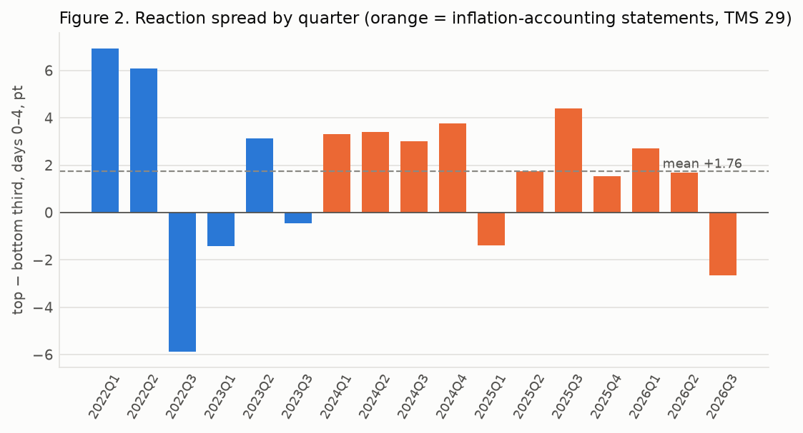

# Report 4 — Quarterly Fundamentals and Post-Disclosure Price Reaction

_Educational research output for CSE-481. Historical evidence only: not a forecast, not investment advice. Returns are nominal TRY._

Generated by `python -m src.reports.build_reports --only 4` from committed outputs, Fintables statements and the
cached price data.

| file | modified | sha256 |
|:---|:---|:---|
| `reports/earnings_events.parquet` | 2026-11-11 12:41:33 | ad007230085a |
| `reports/earnings_by_tercile.csv` | 2026-11-11 12:41:33 | af0615e9f844 |
| `reports/earnings_spread_tests.csv` | 2026-11-11 12:41:33 | 64cca043c691 |
| `reports/earnings_spread_by_quarter.csv` | 2026-11-11 12:41:33 | 7b63b3ef1c0d |
| `reports/kap_disclosure_dates.csv` | 2026-11-11 10:49:20 | 5db5d94e364e |
| `reports/disclosure_spike_check.csv` | 2026-11-10 14:34:33 | afcb4d80c487 |

## 1. Research question

Project spec §9 and §14: align quarterly financial statements with the moment they became **public**, then ask
whether specific changes (profit, revenue, operating profit, margins, ROE) were historically associated with
**different price reactions**: before, on and after the disclosure, against XU100 and against the sector's peers.
The question is not "good earnings = price rises".

**Short answer.** The market does react to quarterly results, and it reacts to *profitability*, not to sales.

- **Net-income ranking.** Ranked by year-over-year net-income change, top-third companies beat bottom-third
  companies by about **1.4 pt on the event day** and **1.7 pt in the five days before** disclosure (both q < 0.05).
  Part of the move happens before the KAP filing.
- **Which metrics matter.** Operating-income growth and net-margin change separate winners from losers on the event
  day at least as clearly as net income does, in both halves of the sample. Revenue growth, which in high-inflation
  Türkiye is mostly price increases, does not.
- **Drift.** After the first few days there is no reliable further drift for net income (days 1–20: +1.3 pt,
  p = 0.33, and the two halves disagree). The one exception is **ROE improvement**: +2.65 pt over days 1–20 in both
  halves (q = 0.003). It is the most interesting result for future work.
- **Not just the sector.** Against sector peers instead of XU100, the same pattern appears but is weaker
  (q ≈ 0.07–0.12). Part of the reaction is sector-wide, because peers report similar news in the same weeks.

## 2. Data and point-in-time alignment

- **Statements.** Fintables quarterly income statements and balance sheets for the 30 stocks (Step 2), 2022Q1 –
  2026Q3. Banks and other financials (AKBNK, ISMEN, TURSG) have no revenue/operating-profit lines, so
  industrial ratios are computed only for non-financial companies.
- **Disclosure time.** The real KAP publication timestamp of each statement (Step 7B, 545 filings). The
  median filing comes 39 days after the quarter end, and **88%
  are published after 18:00**, after the market closes. The **event day** is therefore the first trading day *after*
  publication, the first day the market could react.
- **Legal deadlines are not enough.** 15% of filings came after the standard
  deadline, mostly 2023Q4 – 2024Q2 (the first inflation-accounting statements, when SPK extended deadlines). Using
  deadlines instead of real dates would have put information into the wrong days.
- **Events.** 545 disclosures. 11 have no event day in the price data,
  3 fall in the earthquake window, leaving **531**.
- **Ranking.** Each quarter, the 30 stocks are ranked by year-over-year net-income change into thirds. Ranking
  within the same quarter removes the common inflation effect (in 2022 the median company's profit roughly doubled
  in nominal TRY). A quarter needs ≥ 15 ranked stocks. 2022Q4 and 2023Q4 drop out, because Fintables lacks the 2022Q4
  quarter for 24 of 30 stocks.
- **Returns.** Abnormal return = stock return − XU100 return over the window, and separately stock return − the
  equal-weight return of its sector peers. Windows are in trading days, with the event day = 0.
- **Statistics.** Each quarter's top-minus-bottom spread is one observation (17 quarters), because stocks in the
  same quarter are not independent. All 22 tests in this report share one Benjamini–Hochberg correction.

## 3. Main result: reaction by net-income ranking

**Table 1. Mean abnormal return vs XU100 by net-income YoY third (%)**

| tercile | n | 5 days before % | event day % | days 0–4 % | days 1–20 % | event-day hit % |
|:---|---:|---:|---:|---:|---:|---:|
| bottom | 167 | -0.10 | -1.34 | -1.23 | 0.58 | 31.1 |
| middle | 165 | 0.62 | -0.64 | -0.89 | 1.27 | 37.6 |
| top | 166 | 1.62 | 0.11 | 0.74 | 1.86 | 50.6 |
| any stock-day (baseline) | – | 0.18 | 0.03 | 0.18 | 0.76 | – |

**Table 2. Top-minus-bottom spread, one observation per quarter (pt vs XU100)**

| window | quarters | top − bottom (pt) | t | p | positive quarters | first half | second half | q (6 windows) | p Bonferroni |
|:---|---:|---:|---:|---:|---:|---:|---:|---:|---:|
| 5 days before | 17 | 1.67 | 2.93 | 0.0099 | 13 | 2.93 | 0.55 | 0.030 | 0.059 |
| event day | 17 | 1.39 | 3.00 | 0.0084 | 12 | 1.88 | 0.96 | 0.030 | 0.051 |
| days 0–1 | 17 | 1.52 | 2.40 | 0.0290 | 11 | 1.53 | 1.51 | 0.058 | 0.174 |
| days 0–4 | 17 | 1.76 | 2.23 | 0.0404 | 12 | 1.89 | 1.64 | 0.061 | 0.242 |
| days 1–5 | 17 | 0.46 | 0.71 | 0.4854 | 10 | 0.37 | 0.54 | 0.485 | 1.000 |
| days 1–20 | 16 | 1.28 | 1.00 | 0.3343 | 11 | -0.23 | 2.79 | 0.401 | 1.000 |

**Reading Table 1, Table 2 and Figure 1.**

- **Before the event.** Top-third companies rise +1.6% above XU100 in the five days before the event day; bottom
  third is flat. The market partly anticipates good results: peers have often reported already, sector data is
  public, analysts publish estimates. We cannot tell anticipation from leakage with this data.
- **On the event day.** Bottom-third companies fall −1.34% vs XU100 and only 31% of them beat the index.
  Top-third companies are roughly flat (+0.11%).
- **Disclosure days are negative on average.** Every group, even companies with profit growth, has a negative
  average event-day return. The average across all events is about −0.6% vs the index, against a +0.03% baseline.
  Combined with the positive pre-event drift, this looks like "buy the rumour, sell the news". We report it as an
  observation, not a tested effect.
- **The spread is significant around the disclosure** (pre-event and event day) and **not after it**: days 1–5
  +0.46 pt, p = 0.49. Once the information is public it is priced within a few days. A rule that buys after reading
  the statement is mostly too late.

## 4. Quarter by quarter

- **Across quarters.** The event-window spread is positive in 12 of 17 quarters and averages +1.76 pt. It is not
  stable.
- **Largest positive quarters.** 2022Q1 and Q2 (+6–7 pt), when nominal profit growth was extreme and dispersion
  between companies was large.
- **Negative quarters.**
  - 2022Q3 (−5.9 pt): results were published in Oct–Nov 2022, during a strong broad rally.
  - 2026Q3 (−2.6 pt): results were published during the Oct–Nov 2026 fund-liquidation sell-off (Report 1). In such
    weeks, market-wide flows dominate company news.
- **Inflation-accounting quarters** (orange, statements under TMS 29) show a steadier positive spread (+1.5 to
  +4.4 pt in most quarters). Real (inflation-adjusted) profit figures may be more informative than the nominal
  figures of 2022–2023. We have too few quarters to test this.

## 5. Against sector peers

**Table 3. Mean abnormal return vs the sector peer basket by net-income third (%)**

| tercile | 5 days before % | event day % | days 0–4 % | days 1–20 % |
|:---|---:|---:|---:|---:|
| bottom | 0.26 | -1.19 | -1.21 | -0.91 |
| middle | 0.22 | -0.64 | -1.56 | 0.23 |
| top | 1.55 | -0.09 | 0.25 | 0.96 |

**Table 4. Top-minus-bottom spread vs peers, one observation per quarter**

| window | quarters | top − bottom vs peers (pt) | t | p | q (all tests) |
|:---|---:|---:|---:|---:|---:|
| 5 days before | 17 | 1.30 | 2.36 | 0.0315 | 0.069 |
| event day | 17 | 1.06 | 2.11 | 0.0507 | 0.093 |
| days 0–4 | 17 | 1.43 | 1.92 | 0.0734 | 0.124 |
| days 1–20 | 16 | 1.87 | 1.29 | 0.2168 | 0.298 |

Against sector peers the top-minus-bottom spread keeps its sign in every window (pre-event +1.30, event day +1.06,
days 0–4 +1.43 pt) but loses significance after correction.

Peers report in the same weeks, and sector-wide news (a bank-sector margin squeeze, steel prices) moves the whole
group. Some of the "stock reaction" is therefore a "sector reaction". The company-specific part is real but
smaller than the XU100-based numbers suggest.

## 6. Which fundamental change does the market react to?

**Table 5. Top-minus-bottom third spread by metric (pt vs XU100, one observation per quarter).** Net income is
in Table 2; it is not repeated here so that it is not counted twice in the multiple-testing correction.

| metric | window | events | quarters | top − bottom (pt) | first half | second half | t | p | q (all tests) |
|:---|:---|---:|---:|---:|---:|---:|---:|---:|---:|
| revenue YoY (non-financial) | event day | 455 | 17 | 0.14 | 1.12 | -0.72 | 0.27 | 0.7937 | 0.794 |
| revenue YoY (non-financial) | days 0–4 | 455 | 17 | 0.71 | 2.00 | -0.45 | 0.83 | 0.4214 | 0.515 |
| revenue YoY (non-financial) | days 1–20 | 455 | 16 | -0.43 | 0.07 | -0.92 | -0.34 | 0.7389 | 0.774 |
| operating income YoY (non-financial) | event day | 455 | 17 | 1.64 | 1.62 | 1.66 | 3.91 | 0.0012 | 0.009 |
| operating income YoY (non-financial) | days 0–4 | 455 | 17 | 1.93 | 2.65 | 1.29 | 2.36 | 0.0316 | 0.069 |
| operating income YoY (non-financial) | days 1–20 | 455 | 16 | -0.82 | -1.24 | -0.40 | -0.70 | 0.4932 | 0.543 |
| net margin change, pt (non-financial) | event day | 455 | 17 | 1.69 | 2.01 | 1.40 | 4.39 | 0.0005 | 0.005 |
| net margin change, pt (non-financial) | days 0–4 | 455 | 17 | 2.36 | 3.09 | 1.72 | 2.84 | 0.0118 | 0.043 |
| net margin change, pt (non-financial) | days 1–20 | 455 | 16 | 1.73 | 1.46 | 2.00 | 1.32 | 0.2081 | 0.298 |
| ROE change, pt | event day | 507 | 17 | 1.14 | 1.93 | 0.44 | 2.52 | 0.0228 | 0.069 |
| ROE change, pt | days 0–4 | 507 | 17 | 1.41 | 2.10 | 0.79 | 1.60 | 0.1281 | 0.201 |
| ROE change, pt | days 1–20 | 507 | 16 | 2.65 | 2.87 | 2.43 | 5.15 | 0.0001 | 0.003 |

**What the market reacts to is profitability, not growth in sales.**

- **Revenue YoY:** event-day spread +0.14 pt (p = 0.79), and the sign flips between halves. In 2022–2024, sales
  growth of 50–100% was mostly inflation, not volume, so it carried little news.
- **Operating income YoY:** +1.64 pt on the event day (q = 0.009), the same size in both halves (+1.62 / +1.66).
  Operating income is the closest line to EBITDA in our data; depreciation is not available.
- **Net margin change:** +1.69 pt on the event day (q = 0.005) and +2.36 pt over days 0–4 (q = 0.043), positive in
  both halves. Margins show whether a company passes inflation on to its prices.
- **ROE change:** a moderate event-day reaction, but a **+2.65 pt drift over days 1–20** (t = 5.2, q = 0.003,
  +2.87 / +2.43 in the two halves). This is the only post-disclosure drift that survives correction. We did not plan
  this test in advance and it is one of 22. It is a candidate finding to re-test on new quarters, not a rule.

## 7. Profit direction, losses and financials

The "+48%" for a company whose loss shrank (PETKM, Step 14) showed that a percentage alone can mislead. Here are
the same words the harness now uses (`profit_direction`).

**Table 6. By direction of quarterly net income vs the same quarter a year earlier (%)**

| direction | n | 5 days before % | event day % | days 0–4 % | days 1–20 % | event-day hit % |
|:---|---:|---:|---:|---:|---:|---:|
| profit up | 251 | 1.54 | -0.11 | -0.12 | 1.63 | 45.4 |
| profit down | 129 | -0.22 | -1.24 | -1.91 | -0.12 | 28.7 |
| loss → profit | 41 | 0.72 | -1.04 | 0.43 | 1.15 | 36.6 |
| profit → loss | 57 | -0.45 | -1.29 | -0.10 | 0.90 | 38.6 |
| loss narrowed | 17 | 0.99 | -1.13 | -1.67 | 1.41 | 47.1 |
| loss widened | 12 | -1.19 | -0.97 | 0.89 | 6.43 | 25.0 |

**Table 7. Loss vs profit, financial vs non-financial (%)**

| group | n | 5 days before % | event day % | days 0–4 % | days 1–20 % | event-day hit % |
|:---|---:|---:|---:|---:|---:|---:|
| reported a profit | 444 | 0.87 | -0.52 | -0.63 | 1.00 | 39.4 |
| reported a loss | 87 | -0.27 | -1.26 | -0.31 | 1.64 | 37.9 |
| non-financial | 478 | 0.60 | -0.66 | -0.54 | 0.93 | 39.5 |
| financial (AKBNK, ISMEN, TURSG) | 53 | 1.48 | -0.46 | -0.97 | 2.60 | 35.8 |

- **The worst case is not "profit → loss" but "profit down".** Companies whose profit fell (but stayed positive)
  lose −1.24% on the event day (only 29% beat the index) and −1.91% over days 0–4.
- **Loss → profit and profit → loss** are both negative on the day (about −1%) but recover over 20 days. With
  41–57 events each, these are noisy.
- **Small groups.** "Loss narrowed" (n = 17) and "loss widened" (n = 12) are too small to interpret. The +6.43% for
  "loss widened" is a few large rebounds.
- **Financials vs others.** The three financials react like the non-financials. Banks are ranked on net income and
  ROE only; revenue, operating-income and margin metrics exclude them.

## 8. Strong fundamentals with weak technicals, and vice versa

The technical state is measured at the close **before** the event day: is the price above its 200-day average?

**Table 8. Net-income third × technical state (abnormal return vs XU100, %)**

| tercile | state | n | event day % | days 0–4 % | days 1–20 % |
|:---|:---|---:|---:|---:|---:|
| bottom | above SMA200 | 92 | -1.46 | -1.03 | 0.02 |
| bottom | below SMA200 | 58 | -0.38 | -0.12 | 1.79 |
| middle | above SMA200 | 103 | -1.13 | -1.87 | 1.41 |
| middle | below SMA200 | 44 | 0.05 | 0.67 | 2.03 |
| top | above SMA200 | 129 | -0.18 | 0.44 | 1.60 |
| top | below SMA200 | 21 | 0.96 | 1.87 | 1.78 |

The spec asks to compare good fundamentals with weak technicals and vice versa. The pattern is consistent with
**surprise relative to expectations**, if the price trend is read as a proxy for expectations:

- **Strong trend, weak earnings** (bottom third, price above its 200-day average, n = 92): the largest event-day
  loss (−1.46%). Investors expected more.
- **Weak trend, weak earnings** (n = 58): only −0.38%. The bad news was already in the price.
- **Weak trend, strong earnings** (top third below its 200-day average, n = 21): the best event-window reaction
  (+1.87% over days 0–4), against +0.44% for top-third companies already in an uptrend.

These cells were not tested for significance and the "weak trend, strong earnings" group is small. It is an
interpretation to check on new data. It also shows why the harness never treats strong earnings alone as
sufficient.

## 9. Is there unusual activity in reporting season?

Step 7 compared how often large volume spikes and large abnormal moves happen inside reporting windows vs
outside them (share of stock-days).

**Table 9. Spikes inside vs outside reporting season**

| share of stock-days with | in reporting season | outside season | ratio |
|:---|---:|---:|---:|
| volume z-score > 2 | 0.0334 | 0.0345 | 0.97 |
| volume z-score > 3 | 0.0078 | 0.0071 | 1.11 |
| abs. abnormal return > 4% | 0.0608 | 0.0699 | 0.87 |
| abs. abnormal return > 6% | 0.0186 | 0.0195 | 0.95 |
| both (z > 2 and > 4%) | 0.0135 | 0.0137 | 0.99 |

Reporting season as a whole shows **no more** volume spikes or large abnormal moves than other weeks (ratios
0.87–1.11). The reaction is concentrated on each company's own event day, not spread across the season. This also
argues against widespread pre-announcement trading. The pre-event drift in Table 1 is more likely the market reading
public signals (peers' results, sector data) than leakage. We cannot prove either.

## 10. Multiple testing

22 tests were corrected together; **6** have q < 0.05:

| family | test | p | q (all tests) |
|:---|:---|---:|---:|
| metric spreads | ROE change, pt / days 1–20 | 0.00012 | 0.003 |
| metric spreads | net margin change, pt (non-financial) / event day | 0.00046 | 0.005 |
| metric spreads | operating income YoY (non-financial) / event day | 0.00124 | 0.009 |
| net income spread vs XU100 | event day | 0.00842 | 0.043 |
| net income spread vs XU100 | 5 days before | 0.00991 | 0.043 |
| metric spreads | net margin change, pt (non-financial) / days 0–4 | 0.01181 | 0.043 |

- **Six of 22 tests survive.** Two are net-income spreads (pre-event and event day), three are the
  operating-income and net-margin event-day/event-window spreads, and one is the ROE drift.
- **All six keep their sign in both halves** of the sample.
- **The 20-day net-income drift does not survive** (p = 0.33). Neither does any vs-peers spread, nor revenue.

The pattern of survivors is economically coherent: profitability measures, around the disclosure. That makes it
more believable than a single isolated p-value would be.

## 11. Türkiye context

- **Nominal profits in 2022–2023.** With annual CPI above 50–80%, the median company's net income grew 75–200%
  year over year in nominal TRY. Ranking within each quarter is essential; raw growth rates would mostly measure
  inflation.
- **Inflation accounting (TMS 29) from 2023 year-end.**
  - KGK announced in November 2023 that companies applying TFRS must restate their 31 Dec 2023 statements for
    inflation.
  - SPK confirmed this for listed companies on 28 Dec 2023 and gave **10 extra weeks** for the first annual reports.
  - This is why 60–80% of 2023Q4–2024Q1 filings in our KAP data came after the usual deadline, and why we use real
    KAP timestamps.
  - Restated figures include a "monetary loss" line, so net income fell sharply for many companies. The 2024Q4
    median net-income change in our data is −73%.
- **Banks were treated differently.** BDDK decided that banks would not restate their 2023 statements. A December
  2025 BDDK decision says banks and other financial institutions will not apply inflation accounting to their
  2025 statements either. AKBNK's figures are therefore not on the same accounting basis as the industrial companies,
  another reason to rank them on net income and ROE only. We did not find a source for the 2024 bank decision.
- **2022Q4 missing.** Fintables lacks 2022Q4 for 24 of 30 stocks, so 2022Q4 and 2023Q4 (which needs 2022Q4 for the
  YoY change) cannot be ranked.

Verified by search: KGK and SPK TMS 29 announcements and BDDK bank decisions for 2023 and 2025
([KGK duyuru](https://www.kgk.gov.tr/Portalv2Uploads/files/Duyurular/v2/Diger/Y%C3%BCksek%20Enflasyonlu%20Sunum%20Para%20Birimine%20%C3%87evrim%20Duyuru.pdf),
[BloombergHT: SPK](https://www.bloomberght.com/spkdan-enflasyon-muhasebesi-aciklamasi-2344793),
[Sözcü: BDDK](https://www.sozcu.com.tr/bddk-dan-enflasyon-duzeltmesi-aciklamasi-p8411),
[Alomaliye: BDDK 2025](https://www.alomaliye.com/2025/12/23/enflasyon-muhasebesi-uygulamasi-banka-ve-finans-sirketlerinde-kaldirildi/)).
From our own data: the filing delays, the missing quarters and the median changes.

## 12. How the harness uses these results

The harness uses this scenario for `FUNDAMENTAL_IMPROVEMENT_CANDIDATE`. The rule requires:

- the latest **public** statement (event day ≤ analysis date) in the top net-income third;
- not a loss;
- no more than 63 trading days since the event day.

The attached history is the top-minus-bottom spread over days 0–4, computed only from events whose window had
closed before the analysis date. The evidence sentence states the quarter, the two net-income amounts, the
direction in words ("profit up", "loss narrowed", …) and the tercile.

Given this report, the label means "recent profitability news was strong". It does **not** predict further gains:

- most of the reaction happens before and on the event day;
- the label can be up to three months old.

ROE improvement, the one metric with post-disclosure drift, is not yet used by the harness. Adding it would need a
pre-registered test on new quarters first.

## 13. Limitations

- **No expectations data.** There is no analyst consensus, so "surprise" is approximated by the change vs the
  same quarter last year and by the price trend.
- **No valuation or liquidity.** We have no share counts or market values (P/E, P/B) and no current
  assets/liabilities (liquidity ratios), so the spec's "valuation changes" and "liquidity" are not covered.
- **Operating income instead of EBITDA.** Depreciation is not in the downloaded statements.
- **Low power.** 17 quarters is a small number of independent observations. 2022Q4 and 2023Q4 are missing.
- **Comparability under TMS 29.** It is not documented whether Fintables restates prior-year figures, so
  year-over-year changes across the switch may mix accounting bases.
- **Same-day reaction partly missed.** For the 12% of filings published during trading hours, part of the reaction
  happens on the publication day, which counts as day −1 here.
- **Small, sensitive groups.** Only three financial companies. Returns are nominal TRY vs XU100 or peers.

## 14. Conclusion

Quarterly fundamentals carry information that the market prices quickly:

- profitability changes (operating income, margins, net income) separate winners from losers around the
  disclosure;
- sales growth does not;
- most of the move happens within a few days, partly before the filing.

"Fundamental strength ≠ guaranteed price increase": strong results in a stock that had already run up reacted
little, and weak results in such a stock were punished most. The harness therefore uses fundamentals as **dated,
point-in-time evidence** next to the technical and sector picture, and only ROE improvement shows a post-disclosure
drift worth testing further.
