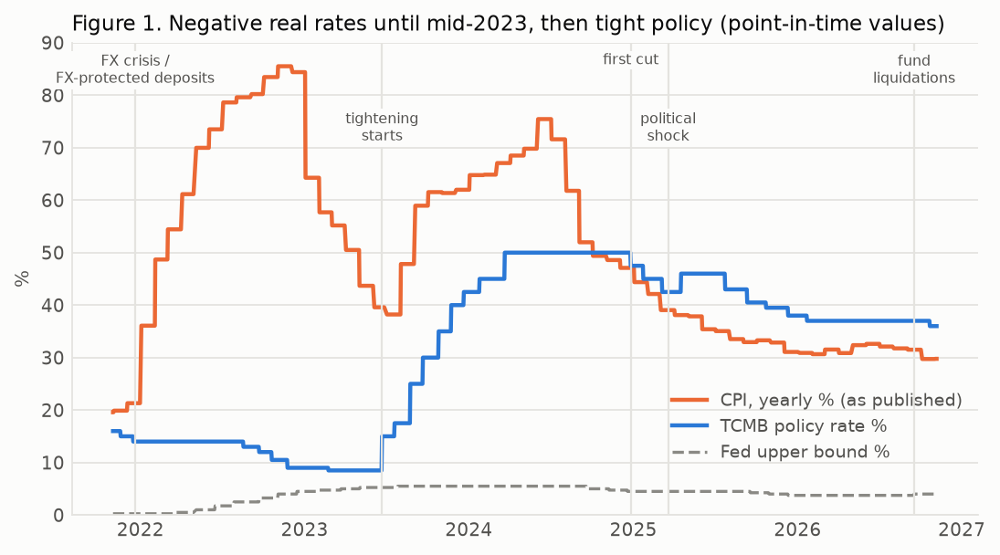
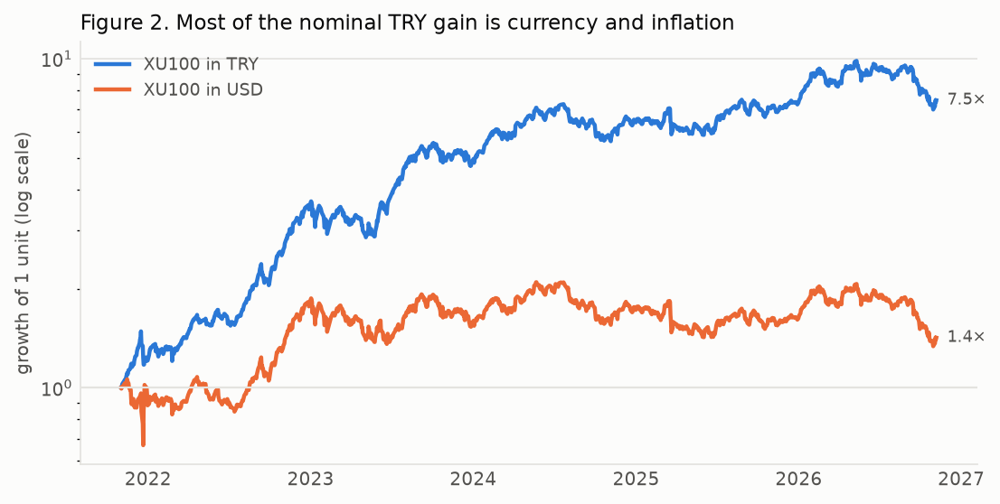

# Report 5 — Macro and Contextual Evidence Integration

_Educational research output for CSE-481. Historical evidence only: not a forecast, not investment advice. Returns are nominal TRY._

Generated by `python -m src.reports.build_reports --only 5` from committed outputs and the cached price data.

| file | size | sha256 |
|:---|:---|:---|
| `reports/macro_panel.csv` | 159 kB | 160ca8d8d783 |
| `reports/news_events.parquet` | 459 kB | 2b169320f310 |
| `reports/news_signal_events.parquet` | 53 kB | 5fd1b0f8f630 |
| `reports/news_reaction_summary.csv` | 2 kB | dc1a316bc755 |
| `reports/speech_features.parquet` | 56 kB | 0cdc3930b15b |
| `reports/speech_claims.csv` | 7 kB | fe19e8f5c0c6 |
| `reports/backtest_strategies.csv` | 6 kB | 7abc36342ce3 |

## 1. Research question

Project spec §15–16 and §25: build the macro, news and speech layers so that every value enters a historical
decision **only from the moment it was public**, and decide what each layer may contribute to the evidence. The
questions are (a) what the macro regime was and how much it explains, (b) whether macro or news context improves
decisions in practice, and (c) how unstructured text (news, speeches) can be used without letting it replace data.

**Short answer.** The context layers are essential for *interpreting* results but did not make better
*trading rules*.

- **Macro explains the numbers.** XU100 rose 7.5× in TRY over five years but only 1.4× in USD, and it lost to
  inflation in every full year except 2022. Most of the "returns" in Reports 1–4 are nominal, which is why every
  report measures against XU100 or peers.
- **Macro as a position-sizing rule hurt.** Halving positions when the macro risk flag is on cut the strategy's
  return from 241% to 176% and barely reduced its worst drawdown (−25% → −22%). In this sample, XU100 actually did
  *better* in the 20 days after the flag turned on (+5.4% vs +3.2%).
- **The lira matters for sectors.** When USD/TRY rises, metal and mining stocks (exporters, a gold miner) beat the
  index and banks lag it. Only the metals result survives correction.
- **News: one useful category.** Of the pre-registered KAP news categories, only "new contract / order"
  disclosures moved prices: +0.5 pt on the day (q = 0.002), mostly ASELS and EKGYO, with no follow-through.
  Negative categories showed no average effect. Adding news to the strategy (E) changed nothing.
- **Speeches: verified claims only.** Of 33 numerical claims in two central-bank speeches, 3 could be verified
  against our data and only those entered the evidence. Forecasts and targets stay as context: expert commentary
  ≠ verified fact.

## 2. Macro layer: sources and point-in-time alignment

**Table 1. Macro variables**

| variable | source | frequency | available on (point-in-time rule) |
|:---|:---|:---|:---|
| USD/TRY, EUR/TRY | TCMB EVDS TP.DK.USD.A.YTL, TP.DK.EUR.A.YTL | daily | known at that day's close |
| TCMB policy rate (1-week repo) | TCMB EVDS TP.PY.P02.1H | daily | decision day (Thursday 14:00) |
| CPI (TÜİK), yearly and monthly change | TCMB EVDS TP.TUKFIY2025.GENEL | monthly | 3rd of the next month (business-day rule), never the reference month |
| Fed funds target range | federalreserve.gov, hand-entered table | per decision | first BIST day after the announcement (announced after BIST close) |
| Real policy rate | policy rate − yearly CPI | daily | from the two inputs above |
| Macro risk flag | XU100 < 200-day average, or 20-day USD/TRY rise in the top 10% of its last 250 days | daily | threshold uses only yesterday's history |

**Table 2. Year by year: the market in TRY, in USD and after inflation**

| year | XU100 in TRY % | USD/TRY % | XU100 in USD % | CPI yearly at year end % | XU100 real (CPI-deflated) % | policy rate at year end % | real policy rate at year end | Fed upper bound at year end % |
|:---|---:|---:|---:|---:|---:|---:|---:|---:|
| 2021 (from 01 Nov) | +20.9 | +36.9 | -11.7 | 21.3 | -0.3 | 14.0 | -7.3 | 0.2 |
| 2022 | +196.6 | +44.1 | +105.8 | 84.4 | +60.8 | 9.0 | -75.4 | 4.5 |
| 2023 | +35.6 | +57.2 | -13.8 | 62.0 | -16.3 | 42.5 | -19.5 | 5.5 |
| 2024 | +31.6 | +19.8 | +9.8 | 47.1 | -10.5 | 47.5 | 0.4 | 4.5 |
| 2025 | +14.6 | +21.7 | -5.9 | 31.1 | -12.6 | 38.0 | 6.9 | 3.8 |
| 2026 (to 06 Nov) | +2.0 | +16.6 | -12.5 | 29.8 | -21.4 | 36.0 | 6.2 | 4.0 |

_CPI-deflated uses year-end yearly CPI; for part-years it overstates inflation._

**The macro regime in three phases** (Figure 1, Table 2):

1. **Nov 2021 – mid 2023: negative real rates.** The policy rate was cut to 8.5% while yearly CPI peaked above 85%
   (late 2022). The real policy rate fell below −75 pt (lowest −76.5 pt in Nov 2022). Equities became an inflation hedge: XU100 rose +197% in 2022,
   the only year with a strongly positive real and USD return (+61% after CPI, +106% in USD).
2. **Jun 2023 – 2024: orthodox tightening.** The policy rate rose from 8.5% to 50% by March 2024. In 2023 the index
   still rose +36% in TRY but fell −14% in USD and −16% after inflation.
3. **Dec 2024 – Nov 2026: slow easing with shocks.**
   - Rates were cut from 50% to 36%.
   - The March 2025 political shock brought a temporary hike to 46% (April 2025, visible in our data).
   - The real policy rate stayed positive (+6–7 pt).
   - The index lagged both the lira and inflation in 2025 and 2026.

**Fed.** The Fed's path (0.25% → 5.5% → cuts to 3.75% → a hike to 4.00% in Sep 2026, from our hand-entered table)
mattered mainly through the dollar. It is far smaller in size than Türkiye's own rate swings.

**Consequence for the project.** A nominal TRY return of +200% in five years is roughly break-even in real
terms. The reports therefore judge signals by **excess return over XU100 or over peers**, never by raw TRY
return.

## 3. Does the macro risk flag help?

The flag is on in 17.6% of trading days. Strategy D is strategy C (fundamental + sector ranking) with half
position size while the flag is on. `D_makro_oynaklik` adds inverse-volatility weights, `D_makro_faiz` also halves
during rate-hiking periods, and `E_haber` adds the KAP news rules (Step 10C).

**Table 3. XU100 after the flag turns on or off (%)**

| horizon | days flag on | XU100 mean if on % | days flag off | XU100 mean if off % | t | p |
|:---|---:|---:|---:|---:|---:|---:|
| next 5 days | 216 | +1.34 | 1,037 | +0.79 | 1.71 | 0.087 |
| next 20 days | 201 | +5.42 | 1,037 | +3.19 | 3.22 | 0.001 |

**Table 4. Strategies with and without the macro and news layers (after 0.15% one-way costs)**

| strategy | period | total return % | XU100 % | equal-weight B&H % | Sharpe | max drawdown % | trades |
|:---|:---|---:|---:|---:|---:|---:|---:|
| C_temel | full | 241 | 189 | 342 | 1.57 | -25 | 536 |
| C_temel | first half | 209 | 118 | 199 | 2.57 | -19 | 287 |
| C_temel | second half | 11 | 33 | 48 | 0.36 | -25 | 249 |
| D_makro | full | 176 | 189 | 342 | 1.39 | -22 | 536 |
| D_makro | first half | 163 | 118 | 199 | 2.37 | -19 | 287 |
| D_makro | second half | 5 | 33 | 48 | 0.23 | -22 | 249 |
| D_makro_oynaklik | full | 169 | 189 | 342 | 1.36 | -22 | 536 |
| D_makro_oynaklik | first half | 164 | 118 | 199 | 2.40 | -19 | 287 |
| D_makro_oynaklik | second half | 2 | 33 | 48 | 0.14 | -22 | 249 |
| D_makro_faiz | full | 111 | 189 | 342 | 1.18 | -22 | 536 |
| D_makro_faiz | first half | 101 | 118 | 199 | 2.23 | -19 | 287 |
| D_makro_faiz | second half | 5 | 33 | 48 | 0.23 | -22 | 249 |
| E_haber | full | 171 | 189 | 342 | 1.39 | -23 | 525 |
| E_haber | first half | 159 | 118 | 199 | 2.38 | -19 | 277 |
| E_haber | second half | 5 | 33 | 48 | 0.22 | -23 | 248 |

The macro risk flag was designed in Step 9 as a defensive rule: weak market trend or a sudden lira depreciation →
hold half positions. The data do not support it as a timing rule:

- **XU100 after the flag.** XU100 rose more in the 20 days after flagged days (+5.42%) than after normal days
  (+3.19%, p = 0.001). In Türkiye a lira shock or a sell-off has often been followed by a rebound: equities are
  bought as an inflation and currency hedge (Dec 2021, mid-2023), and sharp political sell-offs partly reversed
  (spring 2025).
- **Strategies.** Every D variant earns less than C. The interest-rate variant earns the least (111%), and the
  drawdown improves by only 3 pt. Adding the news filter (E) gives 171% vs 176% for D.
- **No help in the second half.** In the tighter second half, all of them lag XU100 (+2–11% vs +33%).

The macro layer stays in the harness as **context and as a gate warning**, not as an automatic sizing rule. This
was the main negative result of Step 9, and Table 3 shows it was not just bad luck in the backtest.

## 4. Which sectors are exposed to the lira?

Daily return of each peer group (equal weight) minus XU100, regressed on the daily % change of USD/TRY
(Newey–West standard errors, 5 lags). A beta of +0.1 means: on a day the lira loses 1%, the group beats XU100 by
0.1 pt on average.

**Table 5. Sector FX sensitivity**

| peer group | stocks | beta to USD/TRY | t (HAC) | p | days | q BH |
|:---|:---|---:|---:|---:|---:|---:|
| Banking | AKBNK, GARAN, ISCTR, YKBNK | -0.131 | -2.25 | 0.025 | 1,257 | 0.123 |
| Retail & Consumer | BIMAS, MGROS, MAVI, CCOLA | -0.052 | -1.79 | 0.073 | 1,257 | 0.243 |
| Construction RE & Utilities | ENKAI, OYAKC, EKGYO, ENJSA, AKSEN | -0.023 | -0.97 | 0.331 | 1,257 | 0.551 |
| Tech Telecom & Defense | ASELS, TCELL, TTKOM | +0.009 | 0.25 | 0.800 | 1,257 | 0.800 |
| Other Financials | KCHOL, ISMEN, TURSG | +0.010 | 0.36 | 0.719 | 1,257 | 0.799 |
| Chemicals & Energy | TUPRS, SASA, GUBRF, PETKM | +0.013 | 0.40 | 0.689 | 1,257 | 0.799 |
| Transportation | THYAO, PGSUS, TAVHL | +0.037 | 0.73 | 0.464 | 1,257 | 0.663 |
| Automotive & Durables | FROTO, TOASO, ARCLK | +0.038 | 1.07 | 0.287 | 1,257 | 0.551 |
| Healthcare | MPARK, ECILC | +0.043 | 1.03 | 0.305 | 1,257 | 0.551 |
| Metals & Mining | EREGL, KRDMD, TRALT | +0.117 | 3.20 | 0.001 | 1,257 | 0.014 |

- **Metals & Mining** (EREGL, KRDMD, TRALT): beta +0.12 (t = 3.2, q = 0.014). Steel exporters and a gold miner
  earn in dollars, so a weaker lira helps them relative to the market.
- **Banking:** beta −0.13 (p = 0.025, q = 0.12 after correction). Lira weakness usually comes with expectations of
  tighter policy and higher funding costs, which hurts bank margins.
- **Retail & Consumer** is mildly negative: import costs and squeezed consumers.
- **Other groups:** close to zero.

These are average daily co-movements, not forecasts. The harness can use them to explain *why* a stock moved on
a lira-shock day, not to predict the next move.

## 5. News layer

**Table 6. News sources in the archive**

| source | items | first | last |
|:---|---:|:---|:---|
| AA | 30 | 2026-11-18 | 2026-11-18 |
| BloombergHT | 50 | 2026-11-17 | 2026-11-18 |
| KAP | 12,905 | 2021-11-01 | 2026-11-18 |
| TRT Haber | 60 | 2026-11-13 | 2026-11-18 |

**Table 7. Most frequent KAP disclosure categories (keyword rules)**

| category | KAP disclosures |
|:---|---:|
| debt issuance (`borclanma`) | 2,505 |
| other (`diger`) | 1,682 |
| warrants (`varant`) | 1,652 |
| share buy-back (`geri_alim`) | 1,172 |
| contracts / orders (`sozlesme`) | 877 |
| routine filings (`rutin`) | 871 |
| management / board (`yonetim`) | 688 |
| insider / major-holder trades (`pay_alim_satim`) | 669 |
| general meeting (`genel_kurul`) | 538 |
| credit rating (`derecelendirme`) | 478 |
| merger / acquisition (`birlesme_satinalma`) | 450 |
| dividend (`temettu`) | 419 |

**Table 8. Scope of tagged items (company / sector / macro / general)**

| source | general | macro | company |
|:---|---:|---:|---:|
| AA | 27 | 3 | 0 |
| BloombergHT | 37 | 13 | 0 |
| KAP | 0 | 0 | 12,905 |
| TRT Haber | 46 | 12 | 2 |

### 5.1 Do KAP news categories move prices?

Rules fixed **before** looking at outcomes (2026-11-18): negative = management departure, delayed financial
statements, lawsuit/penalty, liquidation/bankruptcy; positive = new contract or order, start of a share buy-back.
Event day = first trading day after publication. Abnormal returns are vs XU100, compared with an any-day baseline.

**Table 9. Price reaction by KAP news type (%)**

| direction | kind | events | stocks | 5 days before % | event day % | event day vs base | p (event day) | q (event day) | days 0–4 % | days 1–5 % | too few events |
|:---|:---|---:|---:|---:|---:|---:|---:|---:|---:|---:|:---|
| positive | buy-back programme started | 1 | 1 | -8.59 | -0.88 | -0.92 | – | – | -17.31 | -23.77 | yes |
| positive | new contract / order | 283 | 14 | 0.71 | 0.54 | 0.50 | 0.0006 | 0.002 | 0.55 | 0.05 | no |
| negative | financial statements delayed | 4 | 3 | -6.94 | -0.09 | -0.13 | – | – | -1.42 | -4.22 | yes |
| negative | lawsuit / penalty / investigation | 79 | 16 | 0.38 | 0.00 | -0.03 | 0.9262 | 0.926 | 0.18 | 0.53 | no |
| negative | liquidation / bankruptcy | 14 | 6 | -0.15 | 1.26 | 1.23 | 0.1066 | 0.213 | 1.00 | -0.81 | yes |
| negative | executive departure | 45 | 16 | 0.24 | 0.34 | 0.31 | 0.3294 | 0.439 | 1.32 | 0.91 | no |

**Table 10. Who files the "new contract" disclosures?**

| ticker | contract events |
|:---|---:|
| ASELS | 139 |
| EKGYO | 113 |
| TCELL | 9 |
| THYAO | 7 |
| AKSEN | 5 |

**Sources.**

- **KAP:** the official disclosure platform, the only news source with a full five-year history
  (12,905 disclosures).
- **RSS:** the feeds (AA, BloombergHT, TRT Haber) give only the latest headlines and were archived from
  13 Nov 2026, so they are context for the present, not for backtests.
- **Tagging:** company, sector and macro tags come from keyword rules (Table 7, Table 8). No language model labels
  news.

**Price reaction (Table 9).** The rules were fixed on 2026-11-18, before any outcome was looked at.

- **New contract / order** (283 events, 14 stocks): +0.54% on the event day vs a +0.04% baseline (q = 0.002), and
  some anticipation before (+0.71% in the five days before). There is no further move after day 0 (days 1–5:
  +0.05%), so the information is priced at once.
- **Who drives it:** ASELS (139 events, defence contracts) and EKGYO (113, real-estate tenders) produce most of
  the events, so this is close to a two-company finding.
- **Negative categories** (lawsuits/penalties, executive departures) show **no average negative effect**. Many
  such filings are routine (small fines, planned retirements), and the keyword rules cannot tell a serious event
  from a routine one. "Liquidation" mostly matches the liquidation of small subsidiaries, which is often good news.
- **Small categories:** buy-back starts (1 event) and delayed statements (4) are too rare to interpret.

**How the harness uses news.** It treats negative KAP news as a reason to **investigate** (TURSG, Step 14), not as
a sell signal. Table 9 supports that caution: on average such news is not bad for the price, but in a single case
it can be.

## 6. Speech layer

**Table 11. Speech sources**

| field | fed_20261028 | tcmb_20261112 |
|:---|:---|:---|
| speaker | Kevin Warsh (Fed Chair) | Fatih Karahan (TCMB Governor) |
| channel | Federal Reserve | TCMB |
| title | FOMC Press Conference, October 28, 2026 | Enflasyon Raporu 2026-IV Bilgilendirme Toplantısı |
| published | 2026-10-28 21:30 | 2026-11-12 10:30 |
| language | en | tr |
| segments | 129 | 234 |
| hawkish | 28 | 17 |
| dovish | 0 | 3 |
| uncertain | 18 | 31 |
| in_evidence | 1 | 2 |
| text method | whisper-small | official published text |
| match vs official text | 0.97 | – |

**Table 12. Numerical claims by verification status**

| source_id | consistent with history | forecast or target (cannot be verified) | no data tool for this claim | verified by a data tool |
|:---|---:|---:|---:|---:|
| fed_20261028 | 0 | 6 | 2 | 1 |
| tcmb_20261112 | 1 | 2 | 19 | 2 |

**Table 13. Claims that entered the committed evidence (verified against deterministic tools)**

| source_id | variable | value in speech | value from data tool | status | text (start) |
|:---|:---|:---|:---|:---|:---|
| fed_20261028 | fed_faiz_araligi | 3.75, 4 | 3.75, 4.00 | VERIFIED | Good day This morning the FOMC decided to maintain the target rate for the federal funds r… |
| tcmb_20261112 | tufe_yillik | 29.8 | 29.77 | VERIFIED | Ekim ayında yıllık tüketici enflasyonu yüzde 29,8 olarak gerçekleşti.… |
| tcmb_20261112 | tcmb_politika_faizi | 36 | 36.00 | VERIFIED | Ekim ayı PPK toplantısında politika faizini 100 baz puan indirimle yüzde 36’ya getirdik.… |

**Sources.** No instructor-approved list arrived, so we used only official central-bank sources:

- **Fed, FOMC press conference, 28 Oct 2026.** The audio was taken from the Fed's own video player and
  transcribed with Whisper (small model). It matches the Fed's official transcript at 96.6%.
- **TCMB, Inflation Report briefing, 12 Nov 2026.** We used the official published text. The YouTube video
  required a bot sign-in, which we did not bypass, the same principle as for KAP.

**Claims (Table 12).** Every number in the speeches was extracted and checked against our own data tools:

- **3 verified:** the Fed range 3.75–4.00%, Türkiye's yearly CPI 29.8% and the TCMB policy rate 36%.
- **1 consistent with history:** a past rate path.
- **8 forecasts or targets** (for example the 2% inflation target): they cannot be true or false today.
- **21 with no matching tool** (growth, wages, other variables).

Only the 3 verified claims are allowed into the committed evidence (Table 13). The rest can be shown as context,
labelled as statements by the speaker.

**Stance.** Stance is a keyword count (hawkish / dovish / uncertainty words per sentence). The Fed conference
reads clearly hawkish (28 hawkish sentences, 0 dovish). The TCMB briefing is hawkish in tone but has the most
uncertainty language (31 sentences), while TCMB had just *cut* rates. This shows why tone must not be confused with
action: the data tools, not the speech, tell the harness what the policy rate is.

## 7. How the layers enter the harness

Every analysis builds an **evidence bundle**, and each layer enters it in a controlled way:

- **Macro:** one committed sentence with the policy rate, the latest *published* CPI (with its reference month)
  and the macro risk flag. The quality gate warns if any macro series is missing on the analysis date.
- **News:** KAP disclosures from the last 10 trading days, each with date, category, title and link. A negative
  one blocks candidate labels (→ `INVESTIGATE`, or `REJECT_SIGNAL` if it hits a candidate). Positive ones are shown
  but never create a candidate on their own. The gate warns when a stock has fewer than 3 KAP disclosures in
  180 days (sparse news coverage).
- **Speech:** features of the latest official speech within 30 days: stance counts, topics and **verified**
  claims only. The gate warns about transcript quality problems.

The explanation agents (Step 13) may only use numbers present in this bundle. The numerical validator rejects
anything else. A speech cannot inject a number, and an LLM cannot "remember" a macro value.

## 8. Türkiye context

This report *is* largely the Türkiye context for the project. The dated events used across all reports:

- **20 Dec 2021: FX-protected deposits.** A currency-crisis response, shortly after our sample starts. USD/TRY
  rose 37% in the last two months of 2021 alone (Table 2).
- **2022: negative real rates.** Inflation peaked above 85% in late 2022. Equities became the inflation hedge.
- **6 Feb 2023: earthquakes.** Borsa İstanbul was closed 8–14 Feb 2023 (excluded in all event studies).
- **Jun 2023 – Mar 2024: tightening** from 8.5% to 50% after the May 2023 elections.
- **Dec 2023: inflation accounting (TMS 29)** for listed non-financial companies (Report 4).
- **19 Mar 2025: political shock.** Two circuit-breaker halts, a ~16% weekly loss and an emergency hike to 46%
  (April 2025).
- **17 Sep 2026: fund liquidations.** SPK ordered 131 funds liquidated, followed by a ~25% two-month fall to
  late October 2026. Our data ends on 6 Nov 2026, inside this sell-off.

Verified by search in Reports 1 and 4: the March 2025 and Sep–Oct 2026 events and the TMS 29 decisions. From our
own data: all rate, CPI and FX values and the 2025 hike. From general knowledge: the 2021 scheme and the
earthquake closure.

## 9. Limitations

- **Release dates are rules, not the real calendar.** CPI availability follows a rule (3rd of the next month,
  business-day adjusted), not the actual TÜİK calendar. Data revisions are not modelled; the latest vintage is used.
- **FX rate timing.** The TCMB indicative FX rate is published in the afternoon. We assume it is known at the BIST
  close.
- **Fed table.** The Fed rate table is entered by hand from the Fed's website.
- **News history.** RSS has no history, so all news statistics rely on KAP. Keyword categories are coarse and
  cannot judge severity.
- **Speeches.** Only two speeches, chosen by us because no approved list was provided. There is no speech-day
  event study, so whether speeches move BIST is not tested (an optional extension). Stance is a keyword count.
- **Model choices.** FX betas are simple daily regressions on nominal returns. The macro flag thresholds were fixed
  in Step 9 and not optimised, which keeps the negative result honest but means other thresholds might differ.

## 10. Conclusion

- **What the context layers gave:** they explained *why* raw TRY numbers look the way they do, which sectors move
  with the lira, which news types the market prices, and which statements in a speech are facts.
- **What they did not give:** a better trading rule. The macro filter lowered returns, the news filter changed
  nothing, and the one priced news type (new contracts) is priced on the day.
- **How the project uses them:** as **dated, verified context** in the evidence bundle and as **warnings** in the
  quality gate. The human reviewer sees them next to the numbers, and no layer is allowed to turn an opinion or a
  headline into a number.
