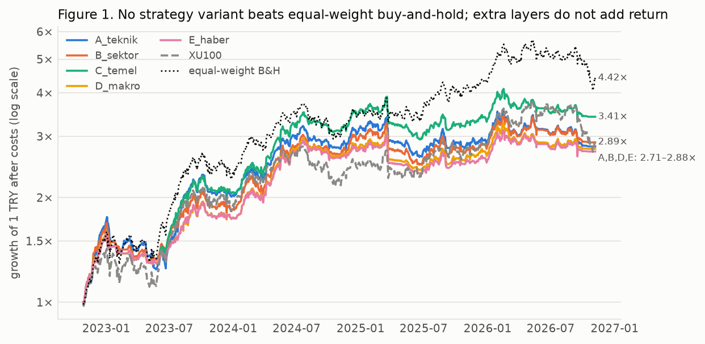
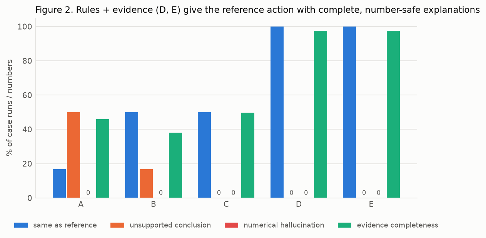

# Report 6 — Backtests, MCP Tools, Stateful Harness, Experiments and Decision Log

_Educational research output for CSE-481. Historical evidence only: not a forecast, not investment advice. Returns are nominal TRY._

Generated by `python -m src.reports.build_reports --only 6`. Backtest curves, the look-ahead self-test, the MCP
tool list and the replays are recomputed when the report is built (no API key needed).

| file | size | sha256 |
|:---|:---|:---|
| `reports/backtest_strategies.csv` | 6 kB | 5266ca6a8032 |
| `reports/backtest_cost_sensitivity.csv` | 1 kB | 5adf4069e31b |
| `reports/harness_experiments.csv` | 1 kB | f4228efab21d |
| `reports/experiments/per_case.csv` | 12 kB | 8ad9869a852a |
| `reports/experiments/raw.jsonl` | 81 kB | 380094d87ece |
| `reports/decision_log.sqlite` | 66 kB | 229dea2a61f3 |

This report covers four deliverables of the project brief (§36): **backtesting results and benchmark comparisons**,
**MCP tool definitions and the stateful harness implementation**, the **agent-harness experiment comparison**, and
the **decision-log and replay demonstration**.

**Short answer.**

- **Backtests.** No rule-based strategy variant beat a simple equal-weight buy-and-hold of the 30 stocks after
  costs. The best variant (C, fundamental filter) beat XU100 over the full period (+24 pt), but every variant lagged
  XU100 in the second half. The macro and news layers (D, E) lowered returns. The backtest engine passes its own
  look-ahead self-test.
- **Harness.** 15 deterministic MCP tools sit under a fixed 17-state machine with per-state tool permissions,
  a rule-based action, a quality gate, human review and a SQLite decision log.
- **Experiments.** The version comparison shows what each layer adds:
  - **Tools alone** (B) improve the action from 17% to 50% agreement with the evidence-based reference but leave
    unsupported labels.
  - **The state machine** (C) removes the unsupported labels and forces backtests.
  - **The evidence bundle and gate** (D, E) give the reference action with complete, number-safe explanations.
- **Numbers.** After fixing a validator false alarm, no version invented numbers. The differences are in **which
  action** is chosen and **how completely** the evidence is explained.
- **Replay.** Replaying the real decision log with today's code reproduces the same actions and gates and correctly
  reports what changed since the decisions were made: the procedure, and one data file (the earnings table rebuilt
  by the point-in-time fix of 22 November).

## 1. Backtests and benchmarks

### 1.1 Strategy variants (spec §29)

All variants are long-only and rebalanced weekly. Each holds up to 10 stocks with equal weights, and unused
weight stays in cash at 0%. The decision is made at day t's close and earns day t+1's return. A one-way cost of
0.15% (commission + slippage) is charged on every change of weight. The first 250 trading days
are indicator warm-up and are not evaluated.

| variant | name | rule |
|:---|:---|:---|
| A_teknik | A — technical only | Supertrend up, close > SMA50, no bearish KAMA slope or below-cloud state; ranked by 20-day return vs XU100 |
| B_sektor | B — + sector relative | A without shock stocks; sector laggards (bottom third of 10-day lag) ranked first |
| C_temel | C — + fundamentals | B without stocks whose latest public earnings are in the bottom third |
| D_makro | D — + macro | C at half size while the macro risk flag is on |
| D_makro_oynaklik | D variant | D with inverse-volatility weights |
| D_makro_faiz | D variant | D, also half size during rate-hiking periods |
| E_haber | E — + news | D without stocks with negative KAP news in 10 days; positive news ranked up |

### 1.2 Results

**Table 1. Strategy results after costs (full period and halves; first half = in-sample, second = out-of-sample)**

| strategy | period | total % | annual % | vol % | Sharpe | max DD % | win days % | in market % | entries | costs % | vs equal-weight pt | vs XU100 pt | info ratio |
|:---|:---|---:|---:|---:|---:|---:|---:|---:|---:|---:|---:|---:|---:|
| A_teknik | full | 181 | 29 | 24 | 1.20 | -29 | 56 | 97 | 594 | 18 | -161 | -8 | -0.72 |
| A_teknik | first half | 176 | 66 | 27 | 2.03 | -29 | 57 | 99 | 305 | 9 | -23 | +58 | -0.28 |
| A_teknik | second half | 2 | 1 | 20 | 0.14 | -23 | 54 | 94 | 289 | 9 | -46 | -31 | -1.24 |
| B_sektor | full | 188 | 30 | 22 | 1.29 | -24 | 54 | 95 | 688 | 21 | -154 | -1 | -0.70 |
| B_sektor | first half | 164 | 63 | 25 | 2.10 | -22 | 56 | 95 | 373 | 11 | -34 | +47 | -0.42 |
| B_sektor | second half | 9 | 4 | 20 | 0.31 | -24 | 53 | 94 | 315 | 10 | -39 | -24 | -1.04 |
| C_temel | full | 213 | 33 | 21 | 1.44 | -21 | 55 | 93 | 627 | 19 | -129 | +24 | -0.58 |
| C_temel | first half | 175 | 66 | 24 | 2.23 | -21 | 57 | 93 | 357 | 11 | -23 | +57 | -0.32 |
| C_temel | second half | 14 | 7 | 18 | 0.44 | -21 | 53 | 92 | 270 | 8 | -34 | -19 | -0.90 |
| D_makro | full | 163 | 27 | 20 | 1.30 | -21 | 55 | 93 | 627 | 18 | -178 | -26 | -0.81 |
| D_makro | first half | 145 | 57 | 23 | 2.10 | -21 | 57 | 93 | 357 | 10 | -54 | +27 | -0.62 |
| D_makro | second half | 7 | 4 | 18 | 0.29 | -19 | 53 | 92 | 270 | 8 | -40 | -25 | -1.04 |
| D_makro_oynaklik | full | 164 | 28 | 20 | 1.31 | -20 | 55 | 93 | 627 | 18 | -177 | -24 | -0.81 |
| D_makro_oynaklik | first half | 148 | 58 | 22 | 2.14 | -20 | 57 | 93 | 357 | 10 | -50 | +30 | -0.59 |
| D_makro_oynaklik | second half | 7 | 3 | 17 | 0.27 | -19 | 54 | 92 | 270 | 8 | -41 | -26 | -1.07 |
| D_makro_faiz | full | 110 | 20 | 17 | 1.16 | -21 | 55 | 93 | 627 | 15 | -231 | -79 | -1.09 |
| D_makro_faiz | first half | 96 | 40 | 17 | 2.05 | -21 | 57 | 93 | 357 | 7 | -103 | -22 | -1.15 |
| D_makro_faiz | second half | 7 | 4 | 18 | 0.29 | -19 | 53 | 92 | 270 | 8 | -40 | -25 | -1.04 |
| E_haber | full | 176 | 29 | 20 | 1.37 | -20 | 56 | 93 | 611 | 17 | -166 | -13 | -0.75 |
| E_haber | first half | 145 | 57 | 23 | 2.11 | -20 | 58 | 93 | 343 | 10 | -53 | +27 | -0.61 |
| E_haber | second half | 12 | 6 | 17 | 0.43 | -17 | 54 | 92 | 268 | 8 | -36 | -20 | -0.90 |

**Table 2. Benchmarks over the same periods**

| period | equal-weight buy & hold % (no cost) | XU100 % |
|:---|---:|---:|
| full | 342 | 189 |
| first half | 199 | 118 |
| second half | 48 | 33 |

**Table 3. Cost sensitivity (total return %, full period)**

| strategy | one-way cost 0.00% | one-way cost 0.15% | one-way cost 0.30% |
|:---|---:|---:|---:|
| A_teknik | 235 | 181 | 135 |
| B_sektor | 254 | 188 | 134 |
| C_temel | 277 | 213 | 159 |
| D_makro | 214 | 163 | 120 |
| D_makro_oynaklik | 218 | 164 | 120 |
| D_makro_faiz | 143 | 110 | 82 |
| E_haber | 228 | 176 | 132 |

**Table 4. Look-ahead self-test of the engine.** A deliberately impossible signal (it holds today's winners)
is run once without the one-day shift and once with it.

| test | total % | Sharpe | max DD % | entries |
|:---|---:|---:|---:|---:|
| signal uses today's return, no shift (deliberate bug) | 511,596,387,642 | 28.41 | -0 | 9,409 |
| same signal, shifted 1 day (correct) | 11 | 0.22 | -73 | 9,397 |
| same signal, shifted, zero cost | 1,075 | 1.77 | -40 | 9,397 |

**Reading Tables 1–4 and Figure 1.**

- **Strong first half, weak second half.**
  - First half (2022-10 – 2024-11, the inflation rally): every variant except the rate filter beat XU100 by
    27–58 pt (the rate filter: −22 pt), but none beat equal-weight buy-and-hold.
  - Second half: every variant earned only +2% to +14% while XU100 rose 33% and equal-weight 48%.
  - A trend-following, long-only rule set that worked in a strong nominal bull market did not survive the
    tight-money period. This is the most important out-of-sample result of the project.
- **Layers do not add return.** Fundamentals (C vs B) helped: +25 pt, with a higher Sharpe (1.44 vs 1.29) and a
  smaller drawdown (−21% vs −24%). Before the point-in-time fix of 22 November (findings 9 and 10) this gain looked
  twice as large (+53 pt): part of it came from earnings information that was not yet public. Macro (D) and news
  (E) cut returns by 37–50 pt. The rate filter cut 103 pt and did not improve the drawdown. The only material
  benefit of D/E is a slightly lower volatility (about 20% vs 21%; the rate filter 17%).
- **Costs matter.** With about 600–700 position entries, cumulative costs are 15–21% of capital. Doubling the cost
  to 0.30% one-way removes 28–54 pt.
- **The engine is honest.**
  - A deliberately impossible "buy today's winners" signal returns an absurd 5 × 10¹¹ % when the one-day shift is
    removed. With the shift it returns +11%.
  - The shift is what prevents look-ahead, and a test (`tests/test_strategies.py`) enforces it.
  - Without costs, the shifted signal earns +1,075%. Yesterday's winners kept winning the next day, the same
    short-term continuation found in Report 3, but the daily turnover makes it worthless after costs.
- **Spec checklist (§18).**
  - Done: signal shifting, publication dates, buy-and-hold and XU100 benchmarks, return / Sharpe / drawdown /
    win rate / benchmark difference, costs, signal counts (no variant had fewer than 30 entries), and
    in-sample/out-of-sample halves.
  - Not done: a rolling walk-forward or a separate validation period (only halves), and a sector benchmark at
    portfolio level. The optional ML layer (§19) was not built.

## 2. MCP tools and the stateful harness

### 2.1 MCP server (spec §22)

`src/mcp_server/server.py` exposes 15 deterministic tools (mcp 2.3 `MCPServer`). Each tool validates its
inputs. Unknown tickers, unknown strategies and dates after the last data day raise a `ToolError` whose message
reaches the agent. All dates are point-in-time (see the data dictionary).

| tool | inputs | output | states |
|:---|:---|:---|:---|
| `get_stock_history` | ticker, start, end | daily High/Low/Close/Volume/turnover with source metadata | LOAD_MARKET_DATA |
| `get_index_history` | index, start, end | XU100 benchmark series | LOAD_MARKET_DATA |
| `calculate_indicators` | ticker, start, end, indicators | SMA/EMA/RSI/MACD/Bollinger/ATR/KAMA/Supertrend/Ichimoku, past data only | CALCULATE_TECHNICALS, RUN_PATTERN_AND_REVERSAL_ANALYSIS |
| `detect_reversal_events` | ticker, start, end, event | timestamped technical events; forward returns only if their window closed by `end` | RUN_PATTERN_AND_REVERSAL_ANALYSIS |
| `find_support_resistance` | ticker, date, tolerance | nearest confirmed support/resistance, touch count and age on a date | CALCULATE_TECHNICALS, RUN_PATTERN_AND_REVERSAL_ANALYSIS |
| `rank_sector_relative_strength` | sector, horizon, date | peer returns, lag vs peer median (self excluded), rank | RUN_SECTOR_RELATIVE_ANALYSIS, RUN_PATTERN_AND_REVERSAL_ANALYSIS |
| `test_weekday_pattern` | ticker, pattern, start, end | weekday or streak pattern vs unconditional returns, half-sample stability, cost note | RUN_PATTERN_AND_REVERSAL_ANALYSIS |
| `get_fundamental_metrics` | ticker, period, asof | latest statement public on `asof`, with publication time | LOAD_FUNDAMENTALS, LOAD_MACRO_CONTEXT |
| `calculate_fundamental_change` | ticker, periods, asof | QoQ / YoY changes of statements visible on `asof` | LOAD_FUNDAMENTALS, LOAD_MACRO_CONTEXT |
| `get_macro_context` | start, end | FX, policy rate, CPI, Fed range as published on each day | LOAD_MACRO_CONTEXT |
| `get_news_events` | ticker, topic, start, end, asof | KAP/RSS headline metadata, source link and timestamp | LOAD_NEWS_AND_SPEECH_CONTEXT |
| `get_speech_features` | source_id | topics, stance, uncertainty, verified vs unverified claims of a speech | LOAD_NEWS_AND_SPEECH_CONTEXT |
| `run_backtest` | strategy, start, end, cost | strategy variant performance (1-day signal shift, costs) and trade summary | PREVIEW_STRATEGIES, RUN_BACKTEST |
| `check_data_quality` | ticker, asof | quality gate: hard blocks, unsafe states, soft warnings | CHECK_DATA_QUALITY, RISK_GATE |
| `build_evidence_bundle` | ticker, asof, analysis_id | observed context + committed evidence + rule action + gate (or read from the log) | BUILD_EVIDENCE |

### 2.2 State machine (spec §23) and agents (spec §20)

The order of states is fixed in code. The LLM cannot choose the next state, and each state opens only the tools
listed. A request for any other tool is blocked and counted as an invalid call. After a hard block, the analysis
states are skipped, but the quality check, risk gate, explanation, human review and logging are not (safe-failure
path). The last three columns show which states each experiment version runs (Section 3).

| # | state | allowed tools | LLM agent | mandatory | safe-failure path | in C | in D | in E |
|---:|:---|:---|:---|:---|:---|:---|:---|:---|
| 0 | START | – | – |  |  | ✓ | ✓ | ✓ |
| 1 | SELECT_UNIVERSE | – | – |  |  | ✓ | ✓ | ✓ |
| 2 | LOAD_MARKET_DATA | `get_stock_history`, `get_index_history` | – |  |  | ✓ | ✓ | ✓ |
| 3 | CHECK_DATA_QUALITY | `check_data_quality` | – | yes |  | ✓ | ✓ | ✓ |
| 4 | CALCULATE_TECHNICALS | `calculate_indicators`, `find_support_resistance` | – |  |  | ✓ | ✓ | ✓ |
| 5 | RUN_SECTOR_RELATIVE_ANALYSIS | `rank_sector_relative_strength` | – |  |  | ✓ | ✓ | ✓ |
| 6 | RUN_PATTERN_AND_REVERSAL_ANALYSIS | `detect_reversal_events`, `test_weekday_pattern`, `calculate_indicators`, `find_support_resistance`, `rank_sector_relative_strength` | Market & Relative-Value |  |  | ✓ | ✓ | ✓ |
| 7 | LOAD_FUNDAMENTALS | `get_fundamental_metrics`, `calculate_fundamental_change` | – |  |  | ✓ | ✓ | ✓ |
| 8 | LOAD_MACRO_CONTEXT | `get_macro_context`, `get_fundamental_metrics`, `calculate_fundamental_change` | Fundamental & Macro |  |  | ✓ | ✓ | ✓ |
| 9 | LOAD_NEWS_AND_SPEECH_CONTEXT | `get_news_events`, `get_speech_features` | News & Speech Intelligence |  |  | ✓ | ✓ | ✓ |
| 10 | BUILD_EVIDENCE | `build_evidence_bundle` | – |  |  |  | ✓ | ✓ |
| 11 | PREVIEW_STRATEGIES | `run_backtest` | Strategy & Backtest |  |  | ✓ | ✓ | ✓ |
| 12 | RUN_BACKTEST | `run_backtest` | – |  |  | ✓ | ✓ | ✓ |
| 13 | RISK_GATE | `check_data_quality` | Risk & Data Quality | yes | yes |  | ✓ | ✓ |
| 14 | GENERATE_EXPLANATION | – | Financial Orchestrator |  | yes | ✓ | ✓ | ✓ |
| 15 | HUMAN_REVIEW | – | – | yes | yes |  |  | ✓ |
| 16 | LOG_AND_CLOSE | – | – | yes | yes |  |  | ✓ |

Deterministic workers (data loading, indicators, events, backtests) are tools, not agents. Six LLM agents only
interpret tool outputs:

- **Market**, **Fundamental & Macro**, **News & Speech**, **Strategy** and **Risk** each summarise their state's
  tool results.
- The **Orchestrator** writes the final explanation from the committed evidence.

The action itself is chosen by rules (`evidence.decide`) from the 8 allowed labels: `HOLD`, `WATCH`, `INVESTIGATE`, `POTENTIAL_CATCH_UP_CANDIDATE`, `TECHNICAL_REVERSAL_CANDIDATE`, `FUNDAMENTAL_IMPROVEMENT_CANDIDATE`, `REJECT_SIGNAL`, `ANALYSIS_UNSAFE`.

### 2.3 Risk and data-quality gate (spec §26)

| outcome | rule |
|:---|:---|
| HARD_BLOCK | unknown ticker |
| HARD_BLOCK | no price / empty close |
| HARD_BLOCK | last price older than 7 days before the analysis day |
| HARD_BLOCK | a daily move above ±10.5% in 250 days (broken history; BIST limit ±10%) |
| HARD_BLOCK | any source date later than the analysis day (future information) |
| HARD_BLOCK | latest visible statement older than 250 days or after the analysis day |
| HARD_BLOCK | backtest ends after the analysis day |
| ANALYSIS_UNSAFE | market-closure window (Feb 2023 earthquake) |
| soft | latest statement older than 150 days; no visible statement |
| soft | a macro series missing on the analysis day |
| soft | fewer than 3 KAP disclosures in 180 days (sparse news) |
| soft | speech transcript quality warning |
| soft | a historical statistic based on fewer than 20 events |
| soft | a historical hit rate below 50% (not better than a coin flip) |
| soft | peer group smaller than 3 |
| soft | backtest flagged (fewer than 30 entries) |
| result | no warnings → PASS; 1–2 → PASS_WITH_WARNINGS; ≥3 → INVESTIGATE |

### 2.4 Memory (spec §24)

| memory | content | implementation |
|:---|:---|:---|
| temporal | prices, indicators, macro, statements, event histories | `data/` caches and `reports/*.parquet`; file hashes stored with every analysis |
| episodic | past cases: state → evidence → action → backtest → human decision | SQLite `analyses` + `human_reviews`; agents see up to 3 earlier cases of the same stock, only with an earlier analysis date |
| procedural | workflow order, action set, gate outputs, rules | `PROCEDURE` in `decision_log.py` (7 rules), hashed into `procedure_version` |

**Design choices, and why.**

1. **Tools compute, agents interpret.** Everything numerical (prices, indicators, events, statements, backtests,
   the gate) is a deterministic MCP tool with point-in-time inputs. Agents read tool results; they never compute.
2. **Fixed workflow.** The state order is code, not an LLM decision. A state can call only its listed tools. A
   blocked request is counted, not executed. Quality checks, the risk gate, human review and logging are mandatory,
   even on the safe-failure path (unknown ticker, earthquake closure).
3. **Rules choose, the LLM explains.** The action comes from `evidence.decide` over the 8 allowed labels and the gate
   status. The Orchestrator may only explain the **committed evidence** (E1, E2, …): sentences generated by code
   from numbers.
   - Every number in every agent's text is checked against the tool outputs.
   - An unsupported number triggers one correction request.
   - What remains is logged.
4. **Humans decide.** Nothing is ever turned into an order. The reviewer's decision and mandatory reason are stored
   next to the AI result, never merged into it.
5. **Memory is dated.** Episodic memory shows an agent at most three earlier cases of the same stock, and only cases
   whose analysis date is earlier than the current one.

## 3. Harness experiments A–E (spec §30)

**Table 5. Versions**

| version | definition |
|:---|:---|
| A | raw LLM: data as text, no tools |
| B | LLM + 15 MCP tools, free use |
| C | tools + state machine (ordered states, per-state tool permissions); LLM picks the action |
| D | C + evidence bundle + quality gate; rules pick the action, LLM explains |
| E | D + episodic memory + human review + decision log (full system) |

**Table 6. Cases** (each run twice; run 2 uses a separate LLM cache so it is a real repetition)

| ticker | date | what it tests |
|:---|:---|:---|
| ASELS | 2026-11-06 | earnings candidate |
| TURSG | 2026-11-06 | shock + negative news |
| PETKM | 2026-11-06 | conflicting technical signals |
| KRDMD | 2026-11-06 | rejected because of a shock |
| ASELS | 2023-02-15 | earthquake window, analysis unsafe |
| YOKBOYLE | 2026-11-06 | unknown ticker |

Model: `gemini:gemini-3.1-flash-lite` (temperature 0) for every row. The reference action is the rule-based
result of the evidence bundle.

**Table 7. Results by version (percentages unless stated)**

| version | case runs | valid action | same as reference | unsupported conclusion | reproducibility (run 1 = run 2) | numerical hallucination | rounding error | evidence completeness | invalid / failed tool calls | look-ahead tool calls | backtest run | tool calls per run | LLM calls per run | seconds per run |
|:---|---:|---:|---:|---:|---:|---:|---:|---:|---:|---:|---:|---:|---:|---:|
| A | 12 | 100.0 | 16.7 | 50.0 | 100.0 | 0.0 | 0.0 | 45.8 | 0.0 | 0 | 0.0 | 0.0 | 1.0 | 28 |
| B | 12 | 100.0 | 50.0 | 16.7 | 100.0 | 0.0 | 4.5 | 38.0 | 0.0 | 0 | 0.0 | 3.2 | 4.0 | 72 |
| C | 12 | 100.0 | 50.0 | 0.0 | 100.0 | 0.0 | 0.0 | 49.7 | 6.0 | 0 | 100.0 | 24.8 | 5.0 | 124 |
| D | 12 | 100.0 | 100.0 | 0.0 | 100.0 | 0.0 | 0.0 | 97.5 | 0.0 | 0 | 83.3 | 22.7 | 5.3 | 11 |
| E | 12 | 100.0 | 100.0 | 0.0 | 100.0 | 0.0 | 0.0 | 97.5 | 0.0 | 0 | 83.3 | 22.7 | 5.3 | 65 |

**Table 8. Action per case and version (run 1; ✗ = differs from the reference)**

| ticker | asof | case | reference (rules) | A | B | C | D | E |
|:---|:---|:---|:---|:---|:---|:---|:---|:---|
| ASELS | 2026-11-06 | earnings candidate | FUNDAMENTAL_IMPROVEMENT_CANDIDATE | TECHNICAL_REVERSAL_CANDIDATE ✗ | WATCH ✗ | WATCH ✗ | FUNDAMENTAL_IMPROVEMENT_CANDIDATE | FUNDAMENTAL_IMPROVEMENT_CANDIDATE |
| TURSG | 2026-11-06 | shock + negative news | INVESTIGATE | WATCH ✗ | TECHNICAL_REVERSAL_CANDIDATE ✗ | WATCH ✗ | INVESTIGATE | INVESTIGATE |
| PETKM | 2026-11-06 | conflicting technical signals | INVESTIGATE | TECHNICAL_REVERSAL_CANDIDATE ✗ | INVESTIGATE | INVESTIGATE | INVESTIGATE | INVESTIGATE |
| KRDMD | 2026-11-06 | rejected because of a shock | REJECT_SIGNAL | WATCH ✗ | INVESTIGATE ✗ | INVESTIGATE ✗ | REJECT_SIGNAL | REJECT_SIGNAL |
| ASELS | 2023-02-15 | earthquake window, analysis unsafe | ANALYSIS_UNSAFE | WATCH ✗ | ANALYSIS_UNSAFE | ANALYSIS_UNSAFE | ANALYSIS_UNSAFE | ANALYSIS_UNSAFE |
| YOKBOYLE | 2026-11-06 | unknown ticker | ANALYSIS_UNSAFE | ANALYSIS_UNSAFE | ANALYSIS_UNSAFE | ANALYSIS_UNSAFE | ANALYSIS_UNSAFE | ANALYSIS_UNSAFE |

**Table 9. Runs with fabricated numbers after the validator fix** (numbers in the explanation that appear in no tool
output). Before the fix, six B runs were flagged; every flagged number was a moving-average window ("20, 50 and
200-day"), see Section 5.

None.

**Table 10. Human reviews in version E (run 1; run 2 reuses the same decision)**

| ticker | asof | action | decision | final | reason (human) |
|:---|:---|:---|:---|:---|:---|
| ASELS | 2026-11-06 | FUNDAMENTAL_IMPROVEMENT_CANDIDATE | ACCEPT |  | gerekçeler olumlu |
| YOKBOYLE | 2026-11-06 | ANALYSIS_UNSAFE | ACCEPT |  | böyle bir kod yok |
| TURSG | 2026-11-06 | INVESTIGATE | ACCEPT |  | dururmu kötü gözüküyor ama genel borsaya göre paralel gitmiş |
| ASELS | 2023-02-15 | ANALYSIS_UNSAFE | ACCEPT |  | açıklamadan dolayı |
| PETKM | 2026-11-06 | INVESTIGATE | ACCEPT |  | yeterince sağlam veri yok  |
| KRDMD | 2026-11-06 | REJECT_SIGNAL | MODIFY | FUNDAMENTAL_IMPROVEMENT_CANDIDATE | yükseliş göstericek durumda |

**Status of this experiment.** It ran on 19–20 November 2026, before the point-in-time fix of 22 November (findings
9 and 10). We recomputed the rule result for all six cases with the corrected data. The action, the secondary
candidates and the gate are unchanged in every case, so the reference labels and the agreement figures below stand.
Some numbers in the evidence the models saw have changed:

| case | evidence item | in the experiment | now |
|---|---|---|---|
| ASELS, KRDMD (2026-11-06) | C backtest return (max drawdown) | 241% (−25%) | 213% (−21%) |
| ASELS, KRDMD | earnings-reaction history, top − bottom over days 0–4 | +1.97 pt (n = 162) | +2.59 pt (n = 131) |
| TURSG, PETKM (2026-11-06) | D backtest return (max drawdown) | 176% (−22%) | 163% (−21%) |
| PETKM | earnings third | top | middle (+48.1% vs cut-off +50.5%) |
| the four 2026 cases | earnings sentence | third within the quarter | third against the previous quarter's cut-offs; amounts with their unit |
| ASELS, 2023-02-15 | D backtest return | 38% | 41% |

The stored explanations therefore quote the pre-fix numbers. The experiment will be re-run once, after the remaining
corrections from the 22 November review, so that explanations and evidence match again.

**What each layer added** (Tables 7–8, Figure 2).

- **A — raw LLM.**
  - **Action:** correct in only 2 of 12 runs, only for the unknown ticker. Half of its labels are
    *unsupported*: a candidate label despite a shock, negative news or a missing condition.
  - **Context it missed:** it labelled TURSG (−39.5% in 20 days, negative KAP news) as `WATCH`, and called the
    earthquake case `WATCH` although the market was closed.
- **B — LLM + tools (free use).**
  - **Tool use:** only about 3 tool calls per run and never a backtest.
  - **Action:** right in 50% of runs, but it called TURSG a `TECHNICAL_REVERSAL_CANDIDATE` despite a shock and
    negative news, the most dangerous error in the table.
  - **Numbers:** after the validator fix (Section 5) it fabricated none and had small rounding errors (4.5% of
    numbers). Tools solved the *numbers* problem but not the *judgement* problem.
- **C — state machine.**
  - **Tool use:** forced to visit every state, it made about 25 tool calls and ran a backtest every time.
  - **Action:** no unsupported conclusions, but it still chose conservative labels in place of the evidence-based
    ones (`WATCH` for the ASELS earnings candidate, `INVESTIGATE` instead of `REJECT_SIGNAL` for the KRDMD shock).
  - **Errors:** 6% of its tool calls failed, mostly on the unknown ticker, where the tool errors were the
    *intended* behaviour.
- **D and E — evidence, gate, memory, human review.**
  - **Action:** 100% agreement with the reference. This is **by construction**: the reference is the rule result
    that D and E use. It shows the harness cannot drift from its rules, not that the rules are right (Reports 1–5
    discuss that).
  - **Explanations:** cover 97.5% of the committed evidence, against 38–50% for A–C, with no fabricated or rounded
    numbers. Semantic mistakes remain, as Section 5 shows.
- **Reproducibility** is 100% for every version. With temperature 0 and a separate cache for the second run, the
  same model chose the same action twice. That is consistency, not correctness: A was consistently wrong.
- **Cost.** D needs about 5 LLM calls and 23 tool calls per analysis. The time column is unreliable: it includes
  cached calls, retries after "503 high demand" errors and, for E run 1, the human's reading time.
- **Human review (Table 10).** The reviewer accepted 5 cases and modified one.
  - **KRDMD override:** `REJECT_SIGNAL` → `FUNDAMENTAL_IMPROVEMENT_CANDIDATE`, reason "it is in a position to
    rise". That reason is a forecast, and it contradicts evidence E4 (a −10% shock day and −15.9% vs XU100 −6.0% in
    20 days). The system allows the override, by design, and keeps the reason for later review.
  - **TURSG reason** ("moved in parallel with the market") also contradicts E2 (−39.5% vs −6.0%).
  - These two cases show why the log must store the human's reasoning, not only the final label: human judgement
    is also fallible and must be reviewable.

## 4. Decision log and replay (spec §27–28)

**Table 11. Where each required log item is stored**

| spec §28 item | where it is stored |
|:---|:---|
| ticker and sector | `analyses.ticker`, `analyses.sector` |
| analysis timestamp and market-data period | `created_at`, `asof`, `data_start`, `data_end` |
| data versions and publication timestamps | `data_versions` (file hashes), `observed` (event days, CPI month) |
| tools called and tool outputs | `tools_called`; full calls and results in `harness_traces.trace` |
| technical / sector / fundamental / macro states | `observed`, `conditions` |
| news and speech source metadata | `observed.news` (KAP links), `observed.speech` (source, time, stance) |
| full evidence bundle and committed evidence | `observed`, `history`, `committed` |
| strategy variant and backtest result | `backtest` |
| risk / data-quality gate status | `gate_status`, `gate` |
| agent conclusion and explanation | `action`, `secondary`, `explanation` |
| human review result and reason | `human_reviews.decision`, `final_action`, `reason` |
| which model and how it behaved | `harness_traces.llm`, `summary` (numbers checked, unsupported) |

**Table 12. Real decision log** (`reports/decision_log.sqlite`; experiment runs are kept in a separate
`reports/experiments/experiment_log.sqlite`, demos in `decision_log_demo.sqlite`)

| analysis_id | created_at | ticker | asof | action | gate_status | llm | decision | final_action | reason |
|:---|:---|:---|:---|:---|:---|:---|:---|:---|:---|
| 2f8d0f98ef03 | 2026-11-18 20:37:40 | ASELS | 2026-11-06 | FUNDAMENTAL_IMPROVEMENT_CANDIDATE | PASS | gemini | MODIFY | WATCH | Bilanço güçlü ama strateji al-tut u geçemiyor; izlenmeli |
| 1065622735f2 | 2026-11-18 20:52:12 | ASELS | 2026-11-06 | FUNDAMENTAL_IMPROVEMENT_CANDIDATE | PASS | gemini | MODIFY | WATCH | bilanço iyi ama yeterli değil. izlemede kalalım |

**Table 13. Replay of every real record with today's code and data**

| analysis_id | same fingerprint | stored action | replayed action | stored gate | replayed gate | changed data files | procedure changed |
|:---|:---|:---|:---|:---|:---|:---|:---|
| 2f8d0f98ef03 | no | FUNDAMENTAL_IMPROVEMENT_CANDIDATE | FUNDAMENTAL_IMPROVEMENT_CANDIDATE | PASS | PASS | reports/technical_events.parquet, reports/earnings_events.parquet | yes |
| 1065622735f2 | no | FUNDAMENTAL_IMPROVEMENT_CANDIDATE | FUNDAMENTAL_IMPROVEMENT_CANDIDATE | PASS | PASS | reports/technical_events.parquet, reports/earnings_events.parquet | yes |

**What the real log contains.** Two real Gemini runs (ASELS, 2026-11-06, made on 2026-11-18 during Step 13). In
both, the rules gave `FUNDAMENTAL_IMPROVEMENT_CANDIDATE`, and the human changed it to `WATCH`. Reason, in
translation: "strong earnings, but the strategy does not beat buy-and-hold; watch it". The `llm` column says only
`gemini` because these runs predate the model-name field. Newer runs store e.g. `gemini:gemini-3.1-flash-lite`.

**What the replay shows (Table 13).** Replaying both records today gives:

- the **same action and the same gate**;
- **one changed data file**: `reports/earnings_events.parquet`;
- **procedure changed = yes**, and a different fingerprint.

That is the correct diagnosis. Since 18 November the rules were extended (the conflicting-signal rule), the evidence
sentences were improved (shock direction, profit direction, units, earnings cut-offs), and on 22 November the
earnings table was rebuilt so that it contains only figures that were public on each event day (findings 9–10).
Neither change alters these two decisions. A replay separates "the data changed" from "our method changed". That is
the purpose of storing data hashes and a procedure hash with every decision.

## 5. Problems found by the system's own checks

The checks built into the system (point-in-time gate, replay, numerical validator, tests) and the experiments
found problems 1–8 during Steps 14–15. Problems 9–10 were found on 22 November, while checking the project brief's
fundamental-analysis requirements against the data. Each was fixed with a test that fails without the fix:

| # | Problem | How it showed up | Fix | Effect on results |
|---|---|---|---|---|
| 1 | Episodic memory had no date filter | version E's 2023 case cited a decision made in 2026 | memory only shows cases with an earlier analysis date | ASELS 2023 E rows re-run |
| 2 | Gemini 3 tool calls need their `thought_signature` sent back | version B failed with HTTP 400 | assistant messages keep `extra_content` | none (crash fix) |
| 3 | Shock evidence had no direction | explanations could not say whether a −10% or +10% day happened | evidence states day, signed move, 20-day stock vs XU100 | D/E re-run for 3 cases |
| 4 | YoY profit % hid sign changes | PETKM "+48%" read as growth although still a loss | `profit_direction` words + both amounts | wording only, not re-run |
| 5 | Technical hit rate ignored direction for bearish events | `kama_turn_down` shown as 49% instead of 51%; PETKM's INVESTIGATE came from the bug | direction-adjusted rate; new conflicting-signal rule | PETKM/KRDMD D/E re-run |
| 6 | A speech published after the close entered that day's analysis | found while writing the data dictionary | speeches selected by event day | none (no case affected) |
| 7 | Validator flagged window lengths ("20, 50 and 200-day") as fabricated | B's "9.4% hallucination" was 6 such numbers | window/horizon lengths excluded like dates | stored explanations re-scored offline: hallucination 0% for all versions |
| 8 | `--mock` demo wrote to the real decision log | found while writing the README | mock runs use the demo database | none |
| 9 | Fintables stores inflation-accounting restatements and re-expressed figures, not the figures published at the time | 2023Q1–Q2 median profit growth was +178% and +209% for the 24 restating companies against +58% and +105% for the other six: restated figures, published a year later, were compared with original ones | point-in-time fundamentals layer: a figure is used only after the version we hold was published, comparisons only within one unit, amounts in the report's money; checked against 20 published figures | 2023Q1–Q3 no longer ranked; with row 10: Report 4's pre-event result and ROE drift no longer significant, C backtest 241% → 213% |
| 10 | Earnings thirds used companies that reported later | an early reporter's third depended on results published weeks later, and on 11 companies that reported after the data end | thirds from the previous quarter's cut-offs, using only figures already published; same-quarter ranking kept as a robustness check (Report 4) | C/D/E backtests, Reports 2 and 4, experiment evidence (Section 3) |

**Not caught automatically.** Some explanations cite the wrong evidence id. The KRDMD orchestrator attributed
technical hit rates to E1 (an earnings sentence) and skipped two evidence items in one run. The validator checks
numbers, not meaning. Catching such errors needs a second check (evidence-id consistency) or the human reviewer.

## 6. Limitations

- **Small experiment.** 6 cases × 2 runs with one model at temperature 0. The cases were chosen to cover failure
  modes, not sampled randomly, so the percentages describe these cases, not general accuracy.
- **Circular reference.** The reference action is the rule result, so D/E agreement is guaranteed. A
  human-labelled reference set would measure whether the *rules* are good.
- **Mixed evidence bases.** Evidence completeness is a heuristic (evidence id cited, a number from the evidence, or
  a topic keyword). For PETKM and KRDMD, A–C were scored against the evidence list before the Step 15 rule changes,
  D/E against the new one. All stored explanations predate the point-in-time fix of 22 November (Section 3).
- **Backtest simplifications.** Halves instead of walk-forward, a fixed 0.15% cost instead of a slippage model, 0%
  interest on cash, weekly rebalancing only, no ML layer.
- **Short decision log.** It holds two real records. A longer history would make episodic memory meaningful.

## 7. Conclusion

The system does what the project brief asks of an analytical harness:

- calculations are deterministic and point-in-time;
- the workflow and tool use are constrained;
- every conclusion is tied to committed evidence;
- numbers in explanations are checked;
- unsafe cases fail safely;
- humans decide;
- everything can be replayed.

The experiments show that the safety comes from the **structure** (state machine, rules, evidence, gate), not from
the model. The same LLM went from 17% to 100% agreement with the evidence-based answer as layers were added. The
backtests show the other half of the lesson: a careful, honest process mostly reports that the tested strategies do
**not** beat buy-and-hold after costs. The harness is built to report exactly that kind of result.
